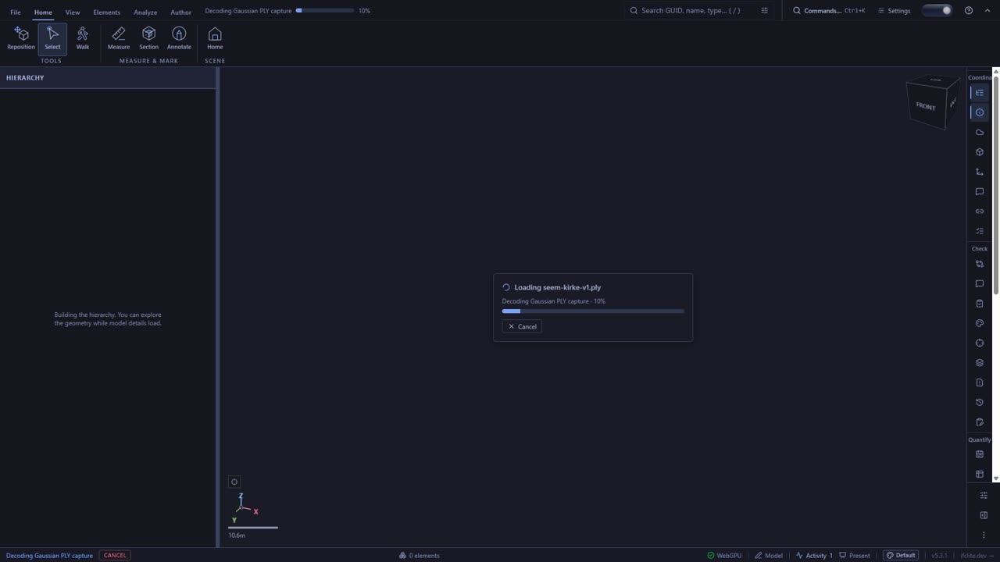
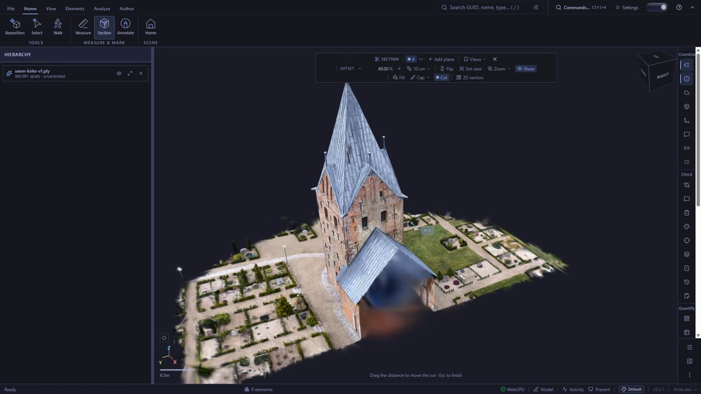
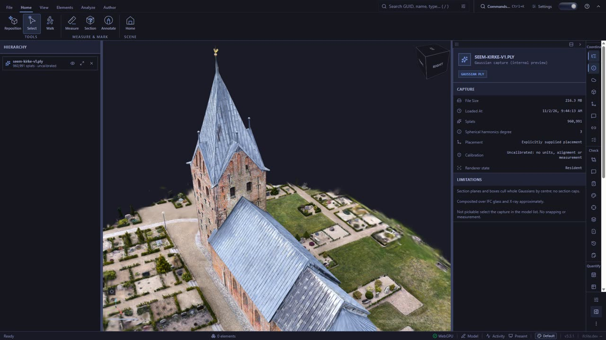
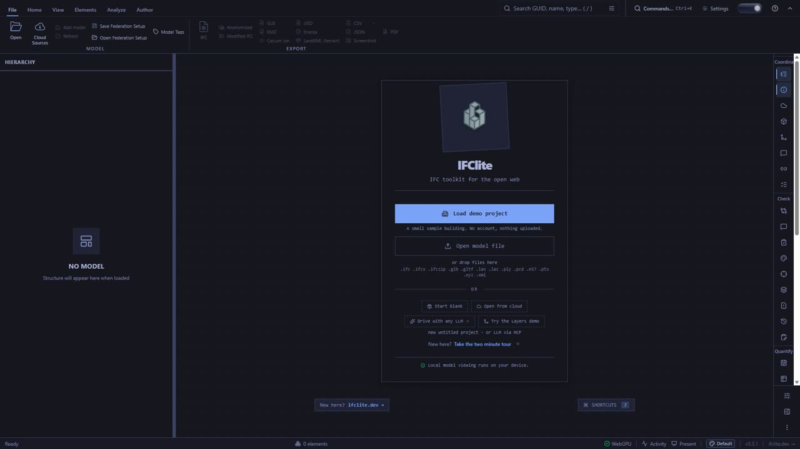

# Showcase recording: integrated viewer, historical internal demo (#8567)

**Historical internal showcase, not production qualified.** The take shows
viewer `16897873e6`, an ancestor of #8644, with renderer checkpoint
`e1da5ef060` merged at `47b6a38991`. It was recorded before the later #8640
renderer fixes (`19cb2d8a0a` bounds, `218005be4d` camera bounds). It is
**not** the current #8644/#8640 runtime: canonical GPU witness run 8 covers
that runtime, at `36802fba87`. It is not production acceptance either.

This is the real ifc-lite viewer:
a production bundle built with `VITE_GAUSSIAN_SPLATS=internal-unqualified`,
rendering through the native WebGPU Gaussian adapter. The capture enters the
viewer's own file picker and takes the canonical `useIfcLoader.loadFile` path.
The take stays outside Git, a 55.6-second MP4/WebM; its hashes are in
[`evidence.json`](evidence.json). The disclosures shown on screen throughout:

- Internal unqualified preview
- Presenter-supplied demo placement (rx180), not alignment
- Uncalibrated: no units or measurement
- Centre clipping: whole Gaussians culled by centre, no caps
- Approximate composition over IFC glass and X-ray
- Not pickable

| Load through the picker | Section tool, centre clipping |
| --- | --- |
|  |  |
| **Inspect the capture** | **Remove the capture** |
|  |  |

Capture: **Seem Kirke, Danmark**, Peter Rødsgaard Rasmussen (roedsgaard),
[superspl.at/scene/e832997f](https://superspl.at/scene/e832997f),
[CC BY 4.0](https://creativecommons.org/licenses/by/4.0/). The published
quantized SOG was converted to PLY (`gaussian/seem-kirke-v1.ply`); the
viewpoint is changed.

## Source and digest binding

- **Viewer source:** `16897873e6`, then local and unpushed. It is now
  reachable as an ancestor of #8644, and through the preservation ref
  `archive/8567-showcase-integrated-viewer-16897873`.
  - Renderer runtime: checkpoint `e1da5ef060`, merged at `47b6a38991`. That is
    older than #8640's `19cb2d8a0a` and `218005be4d`.
  - Later heads at take time: `cfabfaa4e7` adds tests/e2e only; `d8fe061309`
    changes one `import type` line, one type annotation and a doc comment in
    `CaptureModelPanel.tsx`, all erased from emitted JS, plus a manual witness.
- **Loader witnesses:** runs 6 and 7 used a bundle built from `51324723e5`,
  which differs from `16897873e6` only in two test files.
- **Bundle:** dist digest `449e4aab…8a07` over 1,017 files. After normalising
  content hashes, its file set matches the run-6 witnessed copy, and the only
  differences are the embedded build timestamp. WASM `ae7ee826…` comes from
  rust tree `332f265ad1` and is byte-identical across two independent builds.
- **Recorder binding:** that recorder version recorded no commit or dirty
  state. By chronology the take started at 09:44:05, after commit `d9bab8bcfd`
  (09:43:50), with the recorder files unchanged since. This is inferred, not
  recorded. The finisher did record its own binding: `ff219fbd0c`, clean.
- **Environment:** Windows Chrome 156.0.8078.74 (headless) on the PC's NVIDIA
  Blackwell adapter (`isFallbackAdapter: false`), via `ifc-gpu-check`.

## What the take shows

All input is real and on wall-clock time; the CDP page screencast records the
UI and WebGPU canvas together. The journey:

1. Picker load, with the viewer's own "Decoding Gaussian PLY capture" progress.
2. Auto-frame on splat centres.
3. Wheel zoom, then orbit.
4. Section tool "Side (X)", stepped through the nave: whole Gaussians are culled
   by centre, with no caps.
5. Cut off, which restores the full capture.
6. "Show capture details": the capture's own panel. It shows 960,991 splats,
   SH degree 3, "Explicitly supplied placement", "Uncalibrated: no units,
   alignment or measurement" and its limitations, and no IFC claim.
7. Hide, show and fit from the capture's model-list row.
8. "Remove capture", which returns the viewer to its empty state.

The take made no skips and logged no uncaught page exceptions. It did log one
console error, "Failed to load resource: the server responded with a status of
404 (Not Found)". That recorder version did not capture the failing URL, so
for this take the URL is unknown. A later take of `36802fba87` used the
corrected recorder and attributed the same message to
`/_vercel/insights/script.js`, a Vercel analytics script that a local
`vite preview` does not serve. That attribution belongs to the later take
only.

1,597 screencast frames span 55.5 s at p50 33.3 ms. The 17 gaps over 50 ms sit
in the load, the wheel zoom (with its settling into the orbit's first 0.6 s)
and the removal. The outputs are limited range with the BT.709 matrix; that
finisher version left the primaries and transfer untagged (ffprobe: unknown).

**Timing correction:** the historical finisher's concat image input defaulted to
25 fps. The master timestamps were quantized to 40 ms; 261 of its 1,597 adjacent
intervals are zero. MP4 and WebM preserve those already-quantized timestamps,
not the original capture times. The frame-interval statistics above describe
capture diagnostics, not delivered playback timing. Original per-frame capture
timestamps were not retained, so exact timing cannot be recovered by re-finishing
this take. The original files remain unchanged; a new recording with the corrected
millisecond input timebase is needed. The research preview is unaffected.

Two diagnostics from the same session, not performance claims:

- With the right sidebar expanded, the same orbit ran at p90 66.7 ms; with it
  collapsed, at 33.4 ms. The take therefore opens the sidebar only to inspect.
- Wheel zoom steps run at roughly 100–133 ms.
- The viewer's scale bar shows metre values ("9.2m", "6.5m"). The capture is
  uncalibrated, so those values mean nothing; the strip discloses
  "uncalibrated: no units or measurement".

Not qualified here:

- Production readiness or public enablement
- Hardware budgets
- Metric scale or alignment (there is no IFC model in the scene)
- Exact transparency composition and clipping caps
- Picking

The research preview, rendered by the PlayCanvas spike, is in
[`../8567-showcase-research-preview`](../8567-showcase-research-preview/README.md).
