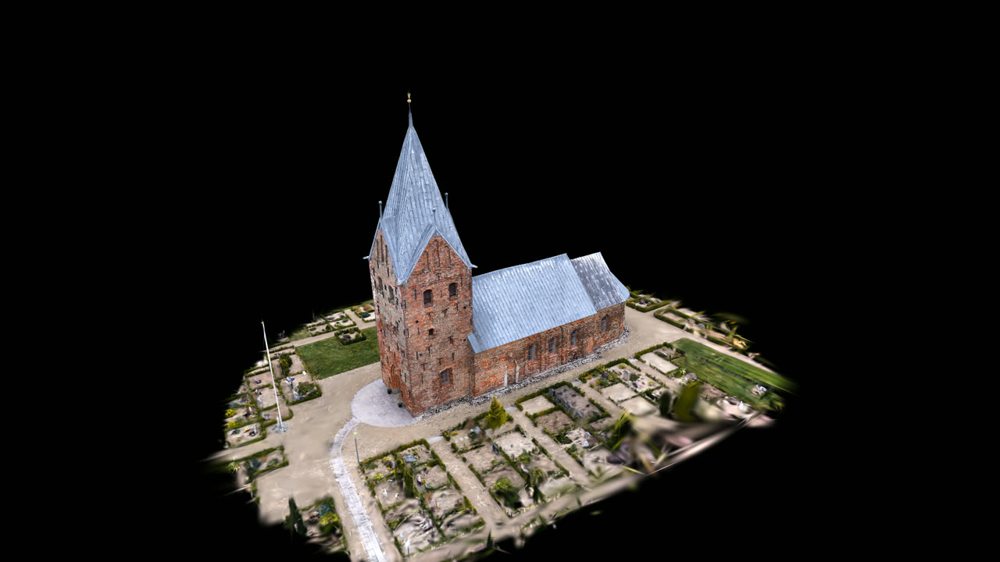
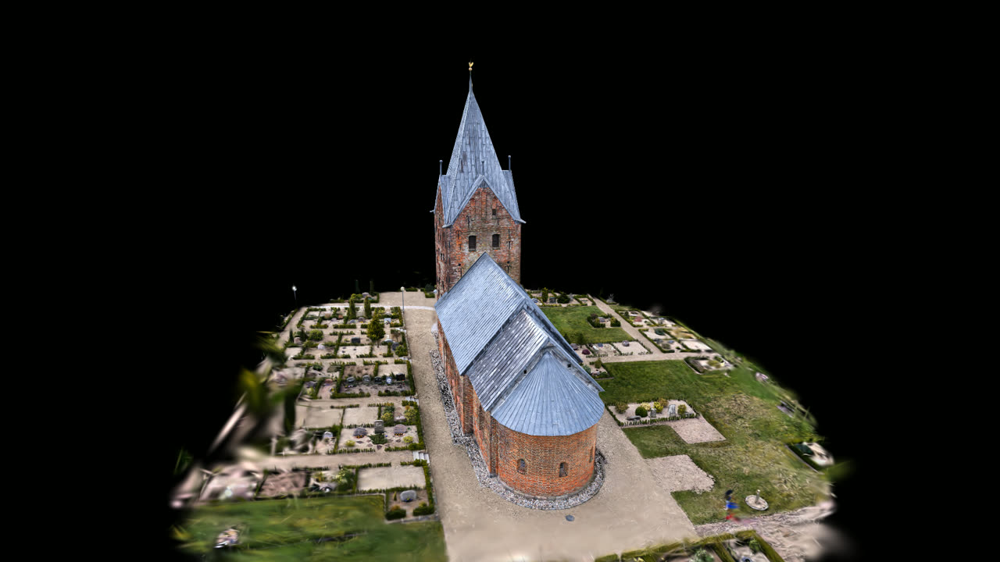
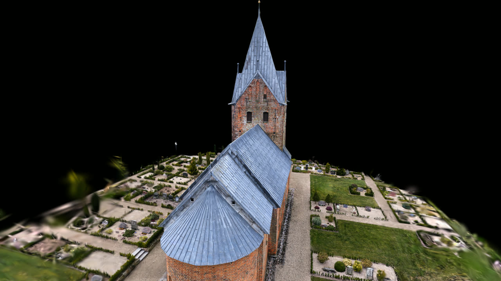
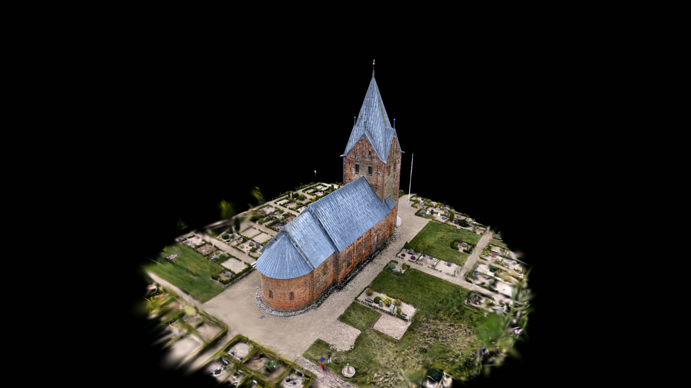

# Showcase recording: research preview (#8567)

**Research preview, not a production showcase.** The upstream PlayCanvas
engine in `examples/gaussian-splat-spike` renders this capture. It does not use
the ifc-lite viewer, `useIfcLoader.loadFile` or IFC-Lite's renderer, and it
draws no IFC overlay. It qualifies no integration, performance, budget, metric
alignment or rollout.

Capture: **Seem Kirke, Danmark**, Peter Rødsgaard Rasmussen (roedsgaard),
[superspl.at/scene/e832997f](https://superspl.at/scene/e832997f),
[CC BY 4.0](https://creativecommons.org/licenses/by/4.0/). The published
quantized SOG was converted to PLY (`gaussian/seem-kirke-v1.ply`); the
viewpoint is changed. The stills below are renders of that capture under the
same licence.

| t = 0 s | t = 15 s |
| --- | --- |
|  |  |
| **t = 22 s** | **t = 30 s** |
|  |  |

The stills are direct texture readbacks from the same session as the take,
downscaled to 1280 px. The take itself, a 30-second MP4/WebM, stays outside
Git. Its hashes are in [`evidence.json`](evidence.json).

## What was recorded

- **Source and renderer:** commit `de7040723b` with a clean
  `examples/gaussian-splat-spike`. After the rebase onto `main` that commit is
  `48f72a6053`; every file the take loaded, the lockfile and the fixture
  manifest are byte-identical. PlayCanvas 2.23.3 GSplat on WebGPU with
  in-frame GPU sorting (renderer 2), and the @playcanvas/splat-transform 3.10.3
  PLY reader.
- **Asset:** 226,795,353 bytes, SHA-256 `9178c736…ab228`, checked in Node before
  serving and again in the browser on the exact fetched bytes. It decodes to
  960,991 splats, matching the manifest count. The 45 higher-order SH channels
  are present but published as zeros.
- **Environment:** Windows Chrome 156.0.8078.74 (headless) on the PC's NVIDIA
  Blackwell adapter (`isFallbackAdapter: false`), started by
  `~/build-workers/ifc-gpu-check` and driven over CDP by Playwright 1.64.1.
- **Placement:** an `x180` display rotation (Y-down training frame to Y-up),
  with no scale. Units stay reconstruction units.
- **Camera:** `demoCameraAt` (30 s, 55° vertical FOV) on wall-clock time inside
  PlayCanvas's update loop. Initial azimuth 330°. The center comes from robust
  opaque-splat bounds. The radius is 19.5, against an automatic 23.40, after a
  stills check along the journey; the closest approach stays outside the
  captured churchyard.
- **Capture:** `canvas.captureStream()` + `MediaRecorder` (VP9, 40 Mbit/s
  requested). 909 engine frames became 904 video frames over 30.28 s. Engine
  frame intervals were p50 33.3 ms and max 34.8 ms. The only video gap,
  199 ms at 0.33 s, falls inside the static opening hold. These timings
  describe this take only and are not performance evidence.
- **Finishing:** ffmpeg 8.0.1 drawtext adds the title, the persistent research
  label and the licence credit. The master, MP4 and WebM have identical frame
  timestamp lists. The full-range capture is mapped to limited-range BT.709.
  The video's first frame matches the direct readback at t = 0 within PSNR
  34.2 dB, with mean luma 46.0 against 46.5.

A first take used `captureStream(30)`. Its rate limiter dropped 107 of 909
engine frames, which showed as a 66 ms judder in every motion window. That
take was rejected and its video discarded; its evidence record is kept.

## Not qualified here

The integrated viewer workflow (load, inspect, orbit, clipping, removal through
the canonical loader and IFC-Lite's renderer), mixed IFC/splat composition,
hardware performance and budgets, and metric alignment all remain open under
#8566 and #8567. The integrated-viewer recording replaces this preview once the
viewer can load Gaussian files.
