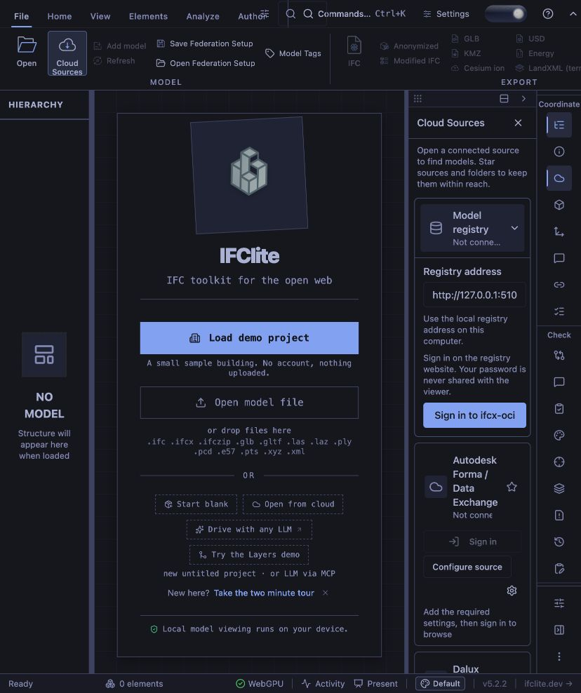
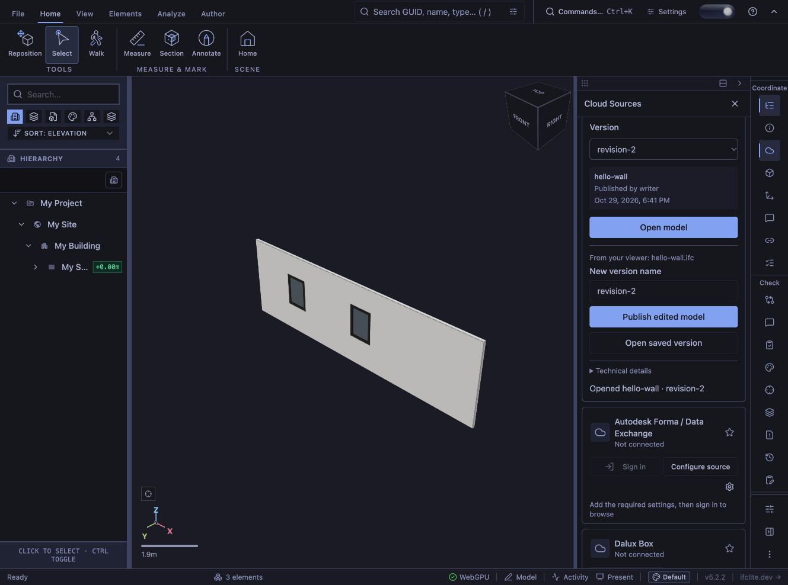

# Registry-owned PKCE sign-in verification

Recorded on 2026-10-29 for PR #8310, using the repository's public
`apps/viewer/public/samples/hello-wall.ifc` and isolated local demo accounts.

The viewer at `http://127.0.0.1:3017` was configured with
`VITE_REGISTRY_ENABLED=true IFC_REGISTRY_TARGET=http://127.0.0.1:5107`.
The companion [ifcx-oci](https://github.com/zahmadsaleem/ifcx-oci) registry ran on
port 5107 with `--oauth-client-id ifc-lite` and the exact registered callback
`http://127.0.0.1:3017/oauth/registry/callback`.

1. The viewer card displayed only a registry address and **Sign in to ifcx-oci**.
   There were no username/password inputs in the viewer.
2. The human completed the real registry popup, which the browser automation
   could not control. The viewer then displayed the connected `writer` account,
   available models and versions, and **Can publish**.
3. The public hello-wall artifact was opened. The viewer reported three geometry
   elements. **Publish edited model** created `revision-2`; **Open saved version**
   reopened that artifact with three geometry elements. This walkthrough did not
   change an IFC property; the export regression test separately checks that a
   pending property edit reaches the exported IFC.
4. An independent ORAS client fetched `revision-2` and its IFC. The received
   source bytes matched the manifest's SHA-256 layer descriptor.

The registry process used the debug binary built during development. The final
backend checkout recorded in [verification.json](verification.json) also includes
later login styling changes; it is not a claimed revision pin for that running
process. Automated integration tests use the supplied current backend binary.

Before sign-in:

After publishing and reopening:

Reproduce the flow using [the local registry guide](../../../guide/local-registry.md).
Artifacts and ORAS credentials stay in temporary/ignored storage; they are not
part of this evidence directory.
