# Geometry Pipeline

Detailed architecture of geometry processing in IFClite.

## Overview

The geometry pipeline transforms IFC shape representations into GPU-ready triangle meshes.

**One pipeline, two orchestrations.** Since the 2026-06 unification series
(#1080 → #1088 → #1084 → shared prepass), per-element mesh production and
prepass resolution exist exactly once, in `ifc-lite-processing`:

- **`processing::element::produce_element_meshes_owned`** in
  `rust/processing/src/element/owned_session.rs` owns the element transaction.
  Native jobs and browser batches share `execution::build_router`, `decode_job`,
  `job_type` and `RouterDrain` (`rust/processing/src/execution.rs`). One owned
  transaction serves two schedulers: native per-job decode/model-wide templates
  and browser warm decode/batch-local templates.
- **`processing::discovery::Discovery`**, `scan::ScanClass` and
  `core::is_geometry_job` share native and browser serial/once discovery.
  Streaming class columns retain the accepted `gpu_meshes/prepass_discovery.rs`
  adapter and incremental scheduler. `discovery::TypeGeometryPlan` shares
  type-map decisions; native `SuppressInstanced` and browser `EmitTagged` are
  explicit policies, not identical configured outputs.
- **`processing::prepass`** resolves collected spans into styles, materials,
  voids, aggregate propagation and unit scales. Native D66 layer slicing is
  default-off (`ProcessingRequest::layer_slicing`); the browser keeps its
  merge-layers toggle. Scheduler caches, frame selection and output encoding
  remain caller-owned.

The native `process(content, request, sink)` entry sequences private phases:
`scan` discovers jobs and plans mapped sources; `resolve` installs the index,
resolves prepass data and filters, then publishes the bootstrap and frame;
`pass` resolves job metadata and meshes chunks; `finalize` collates diagnostics,
instances and result metadata. The bodies live under `processing/src/processor/`.
Native metadata identity runs in parallel and appearance resolution runs serially;
wasm32 uses those same identity and appearance bodies serially. The pass checks
cancellation before each chunk, emits its batches, retains meshes if requested,
and then replays deferred styles. Each job borrows a `PassContext`, with a fresh
`GeometryRouter::from_config` and the existing shared caches and model snapshot.

The native scanner uses `ifc_lite_core::geometry_flags_by_name` to obtain
`(has_geometry, representationless_spatial)` with one lookup of the existing
immutable schema table. These are the same predicates exposed separately by
`has_geometry_by_name` and `is_representationless_spatial_container_by_name`;
the second still requires the instance's `Representation` to be present.

Geometry/styling fixes belong in these shared homes; re-inlining logic in
`processor/` or browser batch adapters re-creates the historic both-sides drift
(#858, #913, #957, #961 each had to be fixed twice before the unification).

The per-representation processing below is shared by construction:

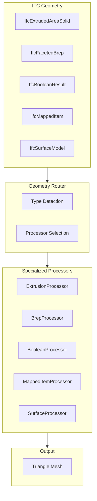

## Geometry Representation Types

### IFC Geometry Hierarchy

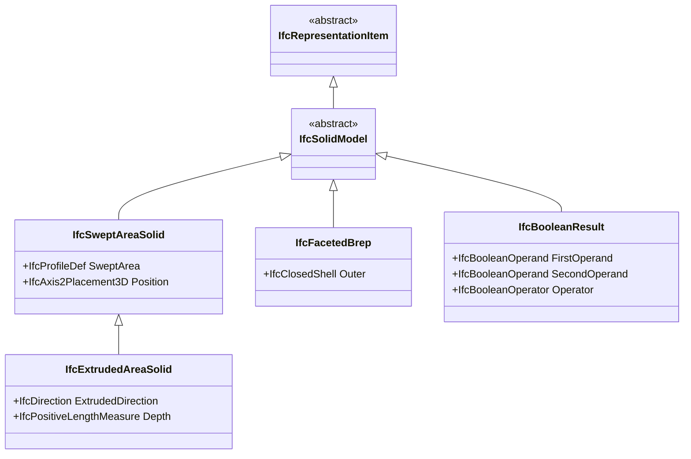

### Coverage by Type

The router's processor registry (`rust/geometry/src/router/processor_registry.rs`)
currently covers 23 distinct `IfcType` representation items across 18
processor structs — including `IfcExtrudedAreaSolid`, `IfcFacetedBrep`,
`IfcBooleanClippingResult`/`IfcBooleanResult`, `IfcTriangulatedFaceSet`,
`IfcShellBasedSurfaceModel`, `IfcFaceBasedSurfaceModel` (the two concrete
`IfcSurfaceModel` subtypes), `IfcAlignment` and more — not the six this
section used to list by hand, which had drifted from source. `IfcMappedItem`
is handled separately, via GPU instancing (`rust/geometry/src/router/instancing.rs`),
not through this processor table, so it is out of scope for the per-entity
ledger below.

The full, generated, per-entity table (which processor is registered for
which representation item, per schema version — the "Geometry" column) is
the [coverage ledger](coverage-ledger.md) — regenerated from
this same source file, so it cannot go stale the way the table above did.

## Extrusion Processing

### Pipeline

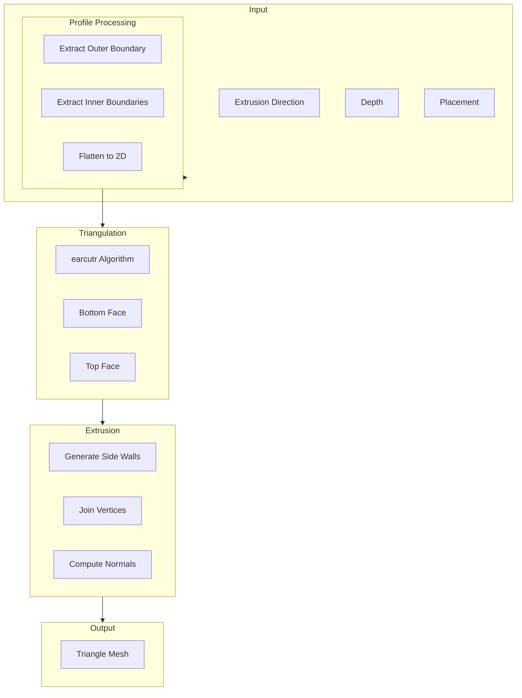

### Profile Types

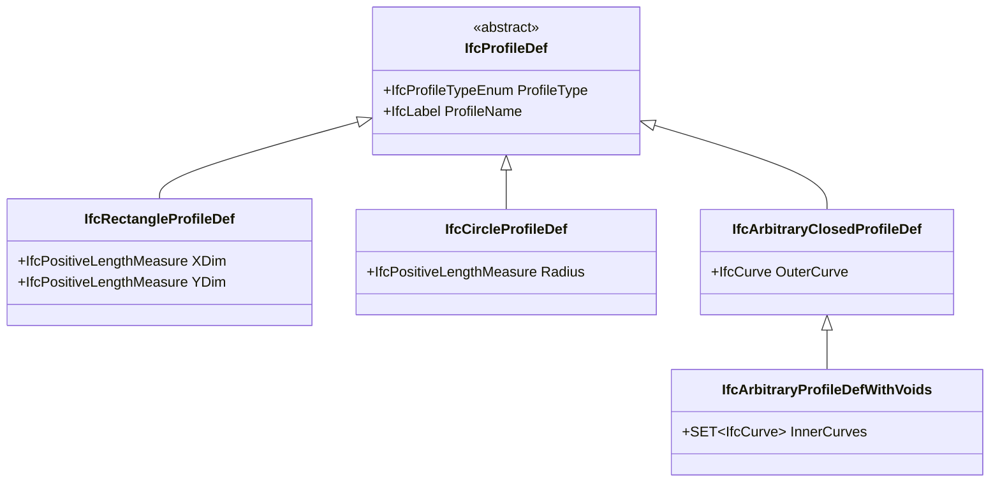

### Earcut Algorithm

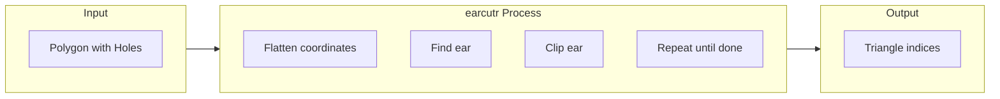

```rust
use earcutr::earcut;

fn triangulate_profile(
    outer: &[Point2],
    holes: &[Vec<Point2>]
) -> Vec<u32> {
    // Flatten to coordinate array
    let mut coords: Vec<f64> = Vec::new();
    let mut hole_indices: Vec<usize> = Vec::new();

    // Add outer boundary
    for p in outer {
        coords.push(p.x);
        coords.push(p.y);
    }

    // Add holes
    for hole in holes {
        hole_indices.push(coords.len() / 2);
        for p in hole {
            coords.push(p.x);
            coords.push(p.y);
        }
    }

    // Triangulate
    earcut(&coords, &hole_indices, 2)
        .unwrap()
        .into_iter()
        .map(|i| i as u32)
        .collect()
}
```

## Brep Processing

### FacetedBrep Pipeline

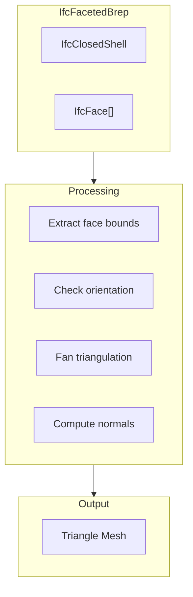

### Face Triangulation

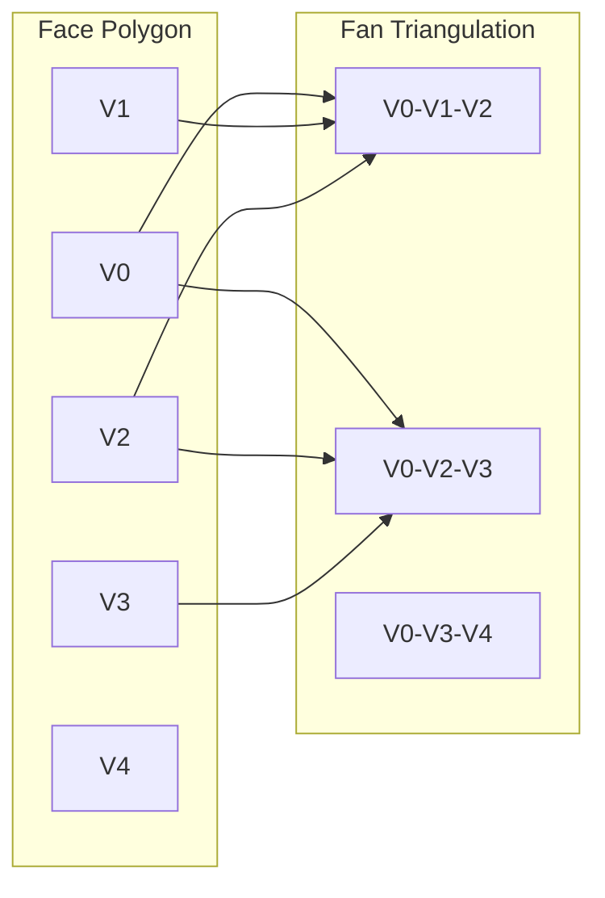

## Boolean Operations

### CSG Pipeline

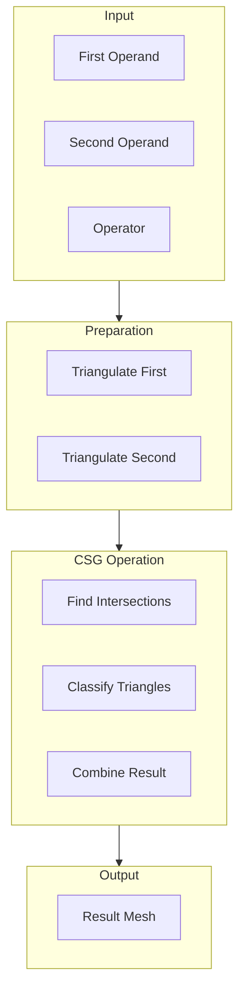

### Boolean Operators

| Operator | Description | Common Use |
|----------|-------------|------------|
| DIFFERENCE | A - B | Wall openings |
| UNION | A + B | Composite shapes |
| INTERSECTION | A ∩ B | Clipping |

### Void Cutting

Opening voids (`IfcRelVoidsElement`, with aggregate propagation from the
prepass) are cut by the owned opening program. `program::openings` classifies
an element's openings ONCE into a `VoidContext` (raw and merged `CutterKind`s,
plus parametric and 2D capture where they reconcile), and every frame part of
the host is cut against it by `Execution::apply_void_context`
(`rust/geometry/src/router/voids/`). That is not one exact path: it is an
ordered chain of statically dispatched stages, and the first that accepts a
host decides its geometry.

| Stage | Steps, in order | Where |
|---|---|---|
| A, whole host | ParamRect (analytic box-minus-boxes in the host's placement frame), Bool2d (2D profile subtract and re-extrude, staged on a provisional child execution), Prism (analytic stepped-prism subtract). First acceptance wins; a residual it leaves is cut by recursion on its result. | `strategy::HOST_STAGES` |
| Origin/frame | World host bounds captured for diagnostics; host and cutters moved into one origin-0 frame. | `apply_void_context` |
| B, frame-local | WallLocalFrame (plan-rotated walls cut in their own frame, one retry on plane-snapped operands when the cut comes back open; a rejected retry restores the first run's diagnostics), facet weld, RectFast (axis-aligned box host, all-rectangular openings). | `Execution::cut_in_frame` |
| C, exact tail | Dense-host subdivision, cutter preparation (rectangles synthesised as box meshes, malformed cutters left to the recut), coaxial union of overlapping coaxial clusters, disjoint batch cut at each group's first member, sequential exact subtract per opening, and the #635 AABB box cut when the kernel fails on an opening that reaches the host. | `strategy::exact::ExactTail` |
| D, post passes | Kernel-failure drain, sliver refinement, malformed recut, flap clip to the pre-cut AABB, stray-shard sweep (only when a pass changed the host), cut-effect record. | `post::finish` |

The #635 fallback is a real, deliberate approximation: it removes the opening's
AABB from a host whose exact cut failed, and its result has an open rim. It is
suppressed when the opening's extended box engulfs the host after an unchanged
cut, and when the host already carries the void; it never runs on an opening the
kernel found disjoint (#5362). Kernel failures are recorded per host as
structured `BoolFailure` records and drained once per frame-local pass.

An opening whose solid engulfs the host empties it. That ends the per-opening
loop: no later opening is cut. The stage D post passes still run on the empty
host (the shard sweep returns at once on it) and record the cut effect with
zero triangles after.
The consumed record is written in ONE place (#8125): when the cut of a host
that had triangles comes back empty, `program::openings::execute` marks it
consumed, so the element keeps the empty result instead of re-rendering the
host uncut. No stage records it itself.

The order of the table is frozen; see
[mesh-determinism.md](mesh-determinism.md#frozen-void-cut-order).

## Mesh Hygiene

Every element's meshes pass through a single funnel (`build_mesh_data` in `ifc-lite-processing::element`) that applies:

- **Degenerate/sliver drops**: `drop_degenerate_triangles` and `drop_thin_triangles` remove zero-area and needle triangles at every output chokepoint (kernel output, funnel backstop), so CSG residue never reaches the GPU.
- **Source vertex weld** (`mesh_weld`, since #4103 run from the router's placement appliers in the OBJECT frame, and at this funnel only for geometry with no cross-occurrence identity to protect — see the `mesh_weld` module doc): collapses vertices with identical f32 position AND coinciding quantized normal (and UV). The faceted-brep mesher emits per-face geometry that duplicates every shared corner 3-6x; the weld undoes that while keeping creases split, because the normal is part of the merge key. Flat shading is preserved by construction (a cube keeps its 24 vertices), and texture seams stay split via the UV key. A naive position-only weld is deliberately NOT used, since it would smooth creases and break flat shading.

The weld and drops are deterministic across native and wasm32 targets.

## Coordinate Transformations

### Placement Stack

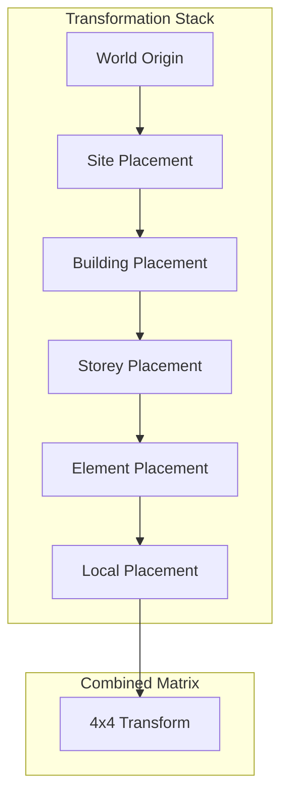

### Matrix Operations

```rust
use ifc_lite_geometry::placement::{resolve_chain, resolve_object_placement};

// The unscaled world transform of a placement (file units), walked up
// `PlacementRelTo` iteratively with a visited set and no depth cap.
let world = resolve_chain(&placement, &mut decoder)?;
// Or from a product's `ObjectPlacement` (`None` when it is `$`).
let world = resolve_object_placement(&product, &mut decoder)?;
```

`resolve_chain` is the placement walk of the router, the 2D profile
extractor and symbolic extraction. Analytic export, appearance, alignment
sampling and map-normalization preflight use the same iterative walk with a
`ChainPolicy`. Nothing in the chain is defaulted: a cyclic chain, a `$`
`RelativePlacement`, a record that is not a placement (as `PlacementRelTo` or as
`RelativePlacement`) and a linear or grid frame that cannot be sampled are each
refused and counted (`EntityDecoder::refused_records`), so the element is lost
visibly instead of drawn at its parent's origin. Symbolic extraction is the one
exception: it drops symbols only for admission refusals (malformed point,
direction or real input and missing mandatory attributes, see
`PlacementError::is_admission_refusal`) and keeps its established unresolved
policy for dangling references, wrong record types and cycles, which place the
symbol at the origin with unknown elevation. A 2D `RelativePlacement` is
honoured. An absent, `$` or `*` `ObjectPlacement` remains identity ("genuinely
missing"); a present value of the wrong kind is refused. An authored linear
`CartesianPosition` is authoritative: an unreadable authored frame does not
fall through to curve sampling. Missing optional directions and readable
degenerate frames retain their existing repair rules. A chain of any length
resolves in full. Execution cancellations and resource refusals propagate as
`PlacementError::ProgramStopped`, retain their terminal source authority, and
do not increment the malformed-record counter.
Symbolic extraction observes the same terminal authority at scan, item and
append boundaries. A terminal stop discards its staged primitives and direct-fill
provenance; it is not converted into malformed input or geometric truncation.
The three public symbolic extraction APIs return `Result<_, ProgramStop>` and
report the exact terminal stop before the execution domain exits. Extraction
installs a lexical terminal domain even without an account, preserving an outer
domain when present. WASM throws on a stop; HTTP parse routes fail before cache
publication, and SSE sends `Error` instead of `Complete`. Successful collection
and wire shapes are unchanged.
The result is memoised on the decoder, **unscaled** and column-major, so
readers with different unit contexts share entries; the caller scales.

`validate_chain` reads local frames through `Axis2Placement`, including the
canonical typed point/direction refusal rule. `strict_spatial` additionally
requires exactly three components, finite nonzero direction norms and
nonparallel Axis/RefDirection after applying the IFC defaults. The same rule
is available for standalone frames as `placement::validate_spatial_frame`.
Readable degenerate axes remain repairable for ordinary rendering; a strict
consumer's additional restriction returns a policy error.

When inspecting many products from one source under one policy, use
`placement::ChainValidator::new(&mut decoder, policy)` and `validate(id)`.
The session returns the root and only the newly verified links, leaf first,
and stops at a previously verified ancestor. It holds the decoder borrow and
keeps its policy fixed. Only successful chains enter this private memo;
transform-cache entries cannot substitute for validation. Linear source
admission shares the renderer's schema-dependent position-slot reader: at least
one RelativePlacement or CartesianPosition must exist in its declared slot,
with the required placement type. Cartesian frames use the typed Axis2 reader. Consumer-specific
linear checks run on the returned new links; export aborts if any fails.

Symbolic extraction retains the full 3D product and conic frames through
composition, then projects to XY. Opposing product and conic tilts can cancel;
projecting each input separately loses that geometry. The length scale applies
to the composed product translation once. Circles keep their exact
circle primitive under similarities. Under a foreshortening projection they
use the bounded sampled-polyline representation already used for ellipses,
including an edge-on circle whose projection is a line. Trimmed circular
arcs likewise transform sampled points rather than multiplying a scalar radius.
Polyline, indexed-curve and fill vertices use the same full frame, including
local Z and the representative vertex elevation. A projected arc becomes a
chord only if it has no interior reversal along that chord; coincident endpoints
can still enclose a visible segment. Text baselines stay unit length after
projection, independently of the scalar text-height convention.

### Large Coordinate Handling

Two mechanisms keep f32 GPU coordinates precise (details in [Coordinate Handling](coordinate-handling.md)):

- **Model-level RTC offset**: the pre-pass samples placement translations of geometry-bearing elements and, when the per-axis median exceeds `LARGE_COORD_THRESHOLD_METERS` (1 km, was 10 km before #4934), subtracts that offset from every mesh.
- **Per-element local-frame origin**: each `MeshData` carries an f64 `origin`; positions are stored as small f32 values relative to it, so building-scale translations never get baked into f32 vertices.

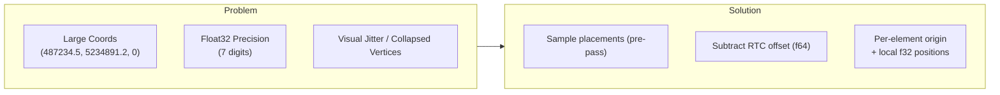

## Quality Modes

### Curve Discretization

Tessellation detail is controlled by a single `TessellationQuality` enum (`rust/geometry/src/tessellation.rs`), exposed as the wasm `setTessellationQuality` setter and the server's `tessellation_quality` query parameter. Segment counts are adaptive: a circle's base count scales with its radius (`clamp(sqrt(r) * 8, 8, 32)`), then the quality level multiplies it.

| Level | Density factor | Use Case |
|-------|----------------|----------|
| `lowest` | 0.25x | Previews, huge models |
| `low` | 0.5x | Mobile |
| `medium` | 1.0x | Default (golden-output identity) |
| `high` | 2.0x | Detailed viewing |
| `highest` | 4.0x | Minimal faceting on curved models |

## Mapped Representations

IFC reuses geometry via `IfcMappedItem`: `MappingSource` references an
`IfcRepresentationMap`, and `MappingTarget` composes with its `MappingOrigin`.
The structural home is `rust/geometry/src/representation/`: `product_shape`
reads a `ProductShape`, `Select::Meshed` selects what renders, and the
decoder-only `RepresentationWalk` visits items in list order with an explicit
DFS stack. Mapped paths use cycle checks, `MAX_MAPPED_ITEM_DEPTH`, and separate
work allowances for mapped attempts and `Items` members. `MappedLevel` returns
transforms in file units; the router scales their translations to metres.

Before rendering, `representation/product_budget.rs` admits roots across the
selected product representations without consulting mesh caches. Repeated
mapped occurrences pay again. On budget exhaustion it retains completed roots
and withholds the current root and all later roots. The profile extractor uses
the same admission for drawings. The private `structural.rs` helpers serve
shallow routing identity, RTC item-id sampling and Reference-only opening
checks; `unwrap.rs` owns the policy-specific first-item/boolean probe chains.

Rendering remains in the controllers under `rust/geometry/src/program/`:

- `ProductControl` consumes admitted roots, merges frame parts or collects
  styled sub-meshes, and applies product placement.
- `ItemControl` selects a processor through the router's `ProcessorRegistry`,
  drives owned construction or extension callbacks, and publishes reports.
  `CacheControl` wraps it with item-cache admission and publication.
- `MappingControl` owns the active source stack. Its `Sink` variants are
  `Occurrence` (cached source then placement), `Shared` (shared source and an
  instance placeholder), `Styled` (per-item sub-meshes), and `TypeMap` (type
  representation parts followed by `MappingOrigin`). Merged/type source items
  use `ItemControl`; styled plain items use `CacheControl`.

The frame boundary is explicit. `router/processing.rs::finish_item_mesh`
validates indices, scales positions and publishes object-frame bounds for
rebased items. Direct items retain `rtc_applied`. Before a mapped-source mesh
is merged or transformed, `MappingControl` calls `keep_rebase_in_origin`
(`router/mapped_item.rs`): it clears that flag and adds the model RTC offset to
the mesh's f64 origin. This preserves precision through mapping and lets final
placement subtract RTC once; `M(p - rtc)` is not `M(p) - rtc` under rotation.
Raw product items instead choose an element-frame offset through the inverse
placement linear transform. See [Coordinate Handling](coordinate-handling.md#geometryrouter).

For the primary model the engine collates
congruent occurrences into **GPU instances**: the wasm
`processGeometryBatchInstanced` entry point (backed by
`rust/geometry/src/instancing` and `processors/mapped.rs`) partitions opaque
ordinary occurrences into per-template instanced shards, and the renderer
uploads each template once as `instancedTemplates` via `addInstancedShard` (see
the rendering guide), then draws every occurrence of a template in a single
instanced draw call. Instancing is enabled by default for the primary model
(`enableInstancing: target.kind === 'primary'` in the viewer loader); federated
loads keep geometry flat. Occurrences that are not eligible for instancing
(transparent glass, or non-ordinary geometry classes) fall back to being
tessellated per placement and grouped by colour into batched draw calls.

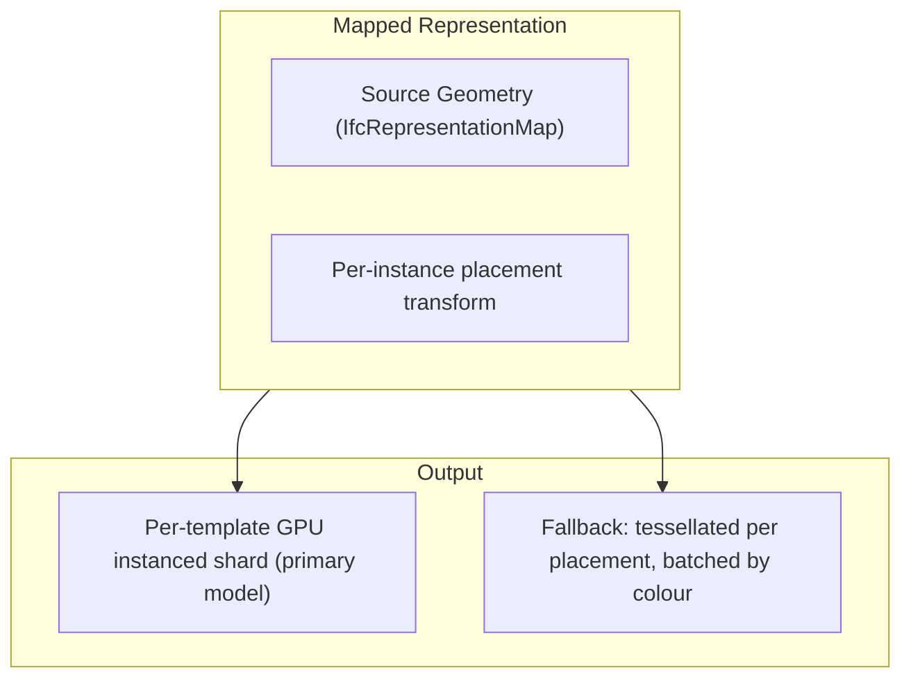

### IFNS shard wire format: v2 carries the source item id

Each occurrence in a shard names the `IfcRepresentationItem` it was tessellated
from, so an instanced piece drills back to source exactly like a flat mesh does
(`MeshData.geometryItemId`; see the [Geometry Guide](../guide/geometry.md)).
Header word 7, a literal `0` nobody read in v1, now holds the **instance record
stride in bytes**. Per-instance fields are append-only in a fixed order: the
88-byte base record (template index, entity id, colour, transform), then the
`itemId` u32 at offset 88 for a stride of 92.

The stride, not a flag word, is what buys forward compatibility. A decoder must
reject a flag bit it does not know, because an unknown bit changes the stride
unknowably and a mis-strided read yields plausible garbage rather than an error.
A stride the decoder *reads* lets it keep every field it knows and step over a
trailing field it does not. So the version gate is permissive and the stride
gate is strict: any version ≥ 2 with a readable stride decodes, a v1 shard (or
word 7 == 0) reads at the 88-byte base, and a stride below the base, off a
4-byte multiple, or one whose instance table cannot fit the buffer, is refused —
by both decoders, so the two statements of the format refuse the same shards.

The encoder derives the stride from the data, declaring 92 only when some
occurrence actually names an item. A model with none pays no per-occurrence
zeros (roughly 800 KB on a 200k-occurrence model, written and cached), and a
shard that declares the field is never all-zero, which is what lets the decoder
expose `DecodedInstancedShard.carriesItemIds` as a real answer rather than a
guess. The predicate is read off the occurrences the encoder actually writes,
not off its input slice, because `collate_refs` drops members and a dropped
id-bearing mesh would otherwise widen the record and fill it with zeros.

A shard whose derived stride is the base record is written as **version 1**,
word 7 at the literal `0` v1 wrote there, so it is byte-identical to a pre-#2985
shard and an older build can still read it. Only a widened record claims v2.
Because the cache stores shard bytes verbatim, a v2 shard under a shared cache
key would be handed to a pre-#2985 decoder (deploy skew, a rollback) that
refuses every version but 1, and the streaming loader swallows that throw — all
instanced geometry gone, silently. So cache `FORMAT_VERSION` moves 15 → 16 with
this change: an old bundle looks for v15 and misses rather than matching, and
existing v1 shards keep loading, without ids, until the model is re-parsed.

## Streaming Pipeline (Browser Worker Pool)

In the browser, `@ifc-lite/geometry` orchestrates a worker pool (`geometry-parallel.ts`):

1. A single **pre-pass worker** runs the WASM streaming scanner. It walks the file once and emits `meta` (RTC offset + unit scales, resolved early), `jobs` chunks (~every 50K entities), and `complete`.
2. On `meta`, N **geometry workers** are spawned. N is memory-budget aware (`worker-count.ts`): capped by cores, device memory, and job count (default hard cap 8), because each worker's WASM linear memory grows to roughly 1.5x the file size in the models measured (the exact ratio varies with model content).
3. Job chunks are distributed with **content-affinity routing**: jobs sharing an affinity key (identical source geometry) land on the same worker, preserving decoder-cache locality.
4. Each worker calls the synchronous WASM `processGeometryBatch` with an **adaptive job budget** (`batch-sizing.ts`): instead of a fixed job count, it targets a fixed wall-time per call and resizes from measured throughput, so dense CSG regions produce small regular heartbeats (keeping the stall watchdog fed) while light regions grow toward the maximum.

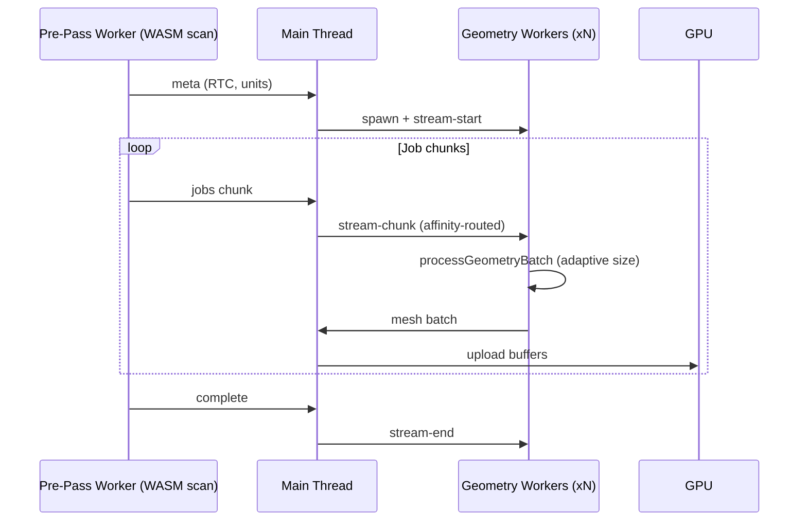

In one measured 1 GB file this dropped time-to-first-batch from roughly 17 s (full pre-pass, then meshing) to 3-5 s. Treat these as observed benchmark figures for that model and machine, not a guarantee for all files or hardware.

## CSG Kernel

ONE kernel: the in-tree **pure-Rust exact mesh-arrangement kernel**
(`rust/geometry/src/kernel/`), on every target — native (server, CLI, SDK)
and `wasm32-unknown-unknown` (viewer) alike. The kernel architecture
(exact predicate cascade, conforming arrangement, winding classification,
deterministic output ordering) is documented in the module docs under
`rust/geometry/src/kernel/`.

Key properties:

- **Exact**: every in/out and on-plane decision routes through exact
  geometric predicates (Shewchuk adaptive floats escalating to exact
  rational arithmetic), so coplanar faces, shared seams and
  flush-cap cuts are decided correctly, not by epsilon.
- **Platform-deterministic**: identical output bytes on x86_64, aarch64
  and wasm32 (pinned by the determinism manifests in
  `rust/geometry/tests/`).
- **No operand cap**: arbitrary operand sizes; cost is bounded by the
  pre-arrangement complexity budget in the void router rather than a
  hard polygon cap.
- **N-ary union**: `kernel::mesh_bridge::union_many` unions all cutter
  prisms in ONE arrangement (issue #960 segmented-roof seams).
- **Failure surface**: on any kernel failure the host mesh is returned
  un-cut and a structured `BoolFailure` record is emitted (drainable via
  `GeometryRouter::take_csg_failures`). The regression gates assert
  `total_failures == 0` on `AC20-FZK-Haus.ifc`,
  `C20-Institute-Var-2.ifc` and `AC-20-Smiley-West-10-Bldg.ifc`.

History (June 2026): two earlier kernels — the legacy BSP port of
csg.js (`bsp_csg.rs`, 128-polygon operand cap, server/wasm default) and
the Manifold C++ kernel (`manifold_kernel.rs` + `manifold-csg-sys`,
viewer/native feature) — were deleted in the kernel consolidation
once the pure-Rust kernel reached parity. With them went the whole
C++ cross-toolchain (cmake, LLVM-20/libc++, emsdk on Vercel) and the
`manifold-csg`/`manifold-csg-wasm-uu` Cargo features; the geometry crate
builds with `default = []` everywhere. There is no kernel selection —
build-time or runtime.

## Performance Metrics

| Operation | Time (typical) | Notes |
|-----------|---------------|-------|
| Profile extraction | 0.1 ms | Per entity |
| Earcut triangulation | 0.5 ms | Simple profile |
| Extrusion | 0.2 ms | Per entity |
| Boolean operation | 5-50 ms | Complex |
| Transform application | 0.01 ms | Per vertex |

### Throughput

- **Simple extrusions**: ~2000 entities/sec
- **Complex Breps**: ~200 entities/sec
- **Boolean operations**: ~20 entities/sec

## Next Steps

- [Rendering Pipeline](rendering-pipeline.md) - WebGPU rendering
- [API Reference](../api/rust.md) - Geometry API

The default browser batch exports adapt their positional arguments to internal
`BatchWire` and borrowed/held `BatchSource` values. Preparation captures one owned
production context; the serial element loop uses the shared execution decode/type
boundary and canonical owned producer. Recovery completes batch-local occurrences
before the flat/IFNS output adapters encode them. Held bytes stay owned through
encoding. Native jobs use the same router builder and diagnostic drain with
per-job policy; their persistent worker caches remain in the native scheduler.
