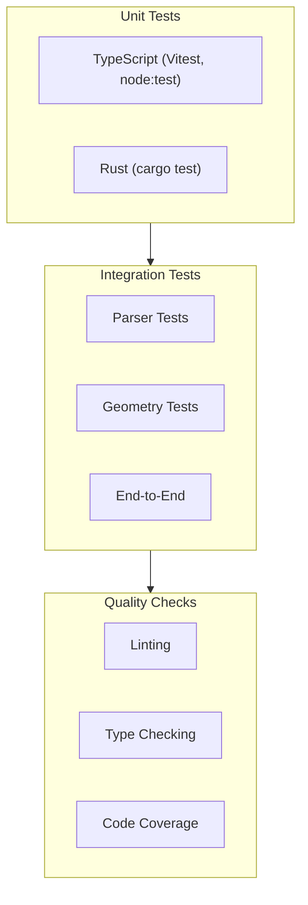

# Testing

Guide to testing IFClite.

## Overview



## Running Tests

### Test Suites

The root `package.json` wires up these suites (most need fixtures, fetched
once with `pnpm fixtures`):

| Command | What it runs |
|---------|--------------|
| `pnpm test` | Package suites via Turbo, using each package's configured runner |
| `pnpm test:e2e` | Playwright viewer end-to-end tests (project `viewer-e2e`) |
| `pnpm test:e2e:ci` | Playwright e2e, CI variant (project `viewer-e2e-ci`) |
| `pnpm test:packed` | Fresh external npm install from local tarballs; installed declarations, headless roundtrip, lifecycle, real WASM geometry and a Vite worker/WASM bundle |
| `pnpm test:integration` | Cross-package integration pipeline (`tests/integration.test.ts`) |
| `pnpm test:api` | Server API tests (`tests/api/`) |
| `pnpm test:wasm-contract` | Real WASM boundary contract tests (run `pnpm build:wasm` first, or it skips) |
| `pnpm test:ids-corpus` | IDS validation corpus |
| `cargo test --workspace` | All Rust tests (run from the repo root) |

### TypeScript Tests

```bash
# Run all TypeScript tests
pnpm test

# Run one package through the dependency graph
pnpm test --filter=@ifc-lite/parser --concurrency=2 -- --maxWorkers=2

# Run one regression file
pnpm test --filter=@ifc-lite/parser --concurrency=2 -- parse-model.test --maxWorkers=2

# Watch mode through the same graph
pnpm test --filter=@ifc-lite/parser -- --watch
```

### Browser-rendered viewer tests

Every viewer test file that imports `apps/viewer/src/test/contrast/render-harness.ts` (the contrast tests and several layout tests) renders the real CSS in a headless Chromium. The harness picks the browser in this order:

1. `IFCLITE_TEST_CHROME_EXECUTABLE`, used as given (a wrong path fails; it never falls back).
2. System Google Chrome (`channel: 'chrome'`), which is what CI uses.
3. Outside CI only: Playwright's bundled Chromium, if `pnpm exec playwright install chromium` already installed it. The harness never downloads a browser, and CI never switches away from the Chrome channel.

With none of them, a local run reports those tests as skipped, with the reason on each one, and ends with a line starting `!! N contrast test(s) SKIPPED, not passed`. A run that prints that line has not checked contrast. In CI (`CI` set, or GitHub Actions) they are never skipped: the launch fails as it always has, and `scripts/check-contrast-skips.mjs` fails a viewer shard whose JUnit report holds any such skip. `scripts/pre-handoff.mjs` reports a revert oracle over these tests as SKIPPED, naming the missing browser, because the oracle runs with `CI=1` and the launch would otherwise fail.

A new test that renders through the harness passes `{ skip: CONTRAST_BROWSER_SKIP }` on each `it`, not on its `describe`: node does not count the tests of a skipped suite, so its summary would show nothing skipped.

### Packed consumer workflows

Build the public packages, then exercise the artifacts a fresh consumer installs:

```bash
pnpm exec turbo build --filter=@ifc-lite/sdk --filter=@ifc-lite/geometry --filter=@ifc-lite/ids --concurrency=2
pnpm test:packed
```

Geometry needs a built WASM runtime, or fetch one with `pnpm build:wasm:fetch`. The check creates tarballs with `pnpm pack`, resolves all first-party dependencies to those tarballs, installs them outside the checkout, and verifies that npm installed real directories with no workspace protocols. Its TypeScript consumer compiles against the installed declarations without workspace aliases.

The runtime consumer queries a model, edits a declared property, exports/reopens it, verifies `GlobalId` and the property, checks unsupported-operation and closed-session errors, and exports real WASM geometry as GLB. The committed wall sample always runs. Fetch `ara3d/AC20-FZK-Haus.ifc` with `pnpm fixtures` for the independently authored five-door case; an absent optional fixture prints an explicit skip. CI provisions and verifies the fixtures before this check.

The same external install also builds a browser entry with Vite and verifies that geometry workers and the WASM binary are emitted. This catches missing worker URLs that a Node-only geometry pass cannot detect.

The check removes its temporary installation on success or failure. Capture its JSON receipt with `pnpm --silent test:packed > packed-receipt.json`. The receipt records package versions and fixture hashes, with no model bytes.

### Local BCF publication peer

Run `pnpm dev:bcf-test-server` from the repository root for a controlled local BCF API peer. It prints its loopback URL, synthetic token and project ID. In the viewer's BCF server connection form, choose a custom URL and the access-token sign-in method, then load the printed project. Use a local viewer origin (`localhost` or `127.0.0.1`); the peer does not allow other browser origins. It holds only in-memory test data and discards that data on shutdown.

Run its integration acceptance through root Turbo:

```bash
TEST_PATTERN='bcf-server.publication' pnpm test --filter=@ifc-lite/viewer --only --env-mode=loose
```

The suite uses actual HTTP requests through the native viewer connector and BCF client. It covers creation/update, human comments, viewpoints referencing a parsed committed SketchUp IFC model, project pull and BCF archive roundtrip, vocabulary rejection, permission loss, and a connection closed after a committed write. This is controlled-peer evidence, not vendor conformance.

The draft/outbox suites run against the same peer (`TEST_PATTERN='bcf-drafts|bcf-publication|BCFDraftsDialog'`). The peer's `loseNextWriteResponse` drops the next committed write's response, and `loseResponsesOfWrites` drops the responses of chosen accepted-write ordinals (1-based), so a test can lose exactly a viewpoint or comment response. Server timestamps use the peer's clock. Snapshot upload, OAuth grants, server-side revision headers and vendor-specific idempotency remain outside this peer's contract.

### Rust Tests

The Cargo workspace root is the repo root:

```bash
# Run all Rust tests
cargo test --workspace

# Run specific crate
cargo test -p ifc-lite-core

# Run specific test
cargo test parse_entity

# With output
cargo test -- --nocapture
```

#### Fuzzing the STEP parser

The entity parser has a coverage-guided fuzz target (`rust/core/fuzz/`). It is
a standalone crate, so it is not built by `cargo build`/`cargo test` or by the
PR test workflow; a scheduled workflow (`.github/workflows/fuzz.yml`) runs it
weekly and on demand. Run it locally with
[`cargo-fuzz`](https://github.com/rust-fuzz/cargo-fuzz) (needs the nightly
toolchain, already pinned):

```bash
cargo install cargo-fuzz
cd rust/core
cargo fuzz run parse_entity -- -max_total_time=60
```

The contract under fuzz is that `parse_entity` never panics, hangs, or overflows
on arbitrary bytes (only returns `Ok`/`Err`). `rust/core/tests/malformed_input.rs` pins the
same contract for specific inputs in normal CI.

## Writing Tests

### TypeScript Tests

Tests sit next to the code they cover (`src/<name>.test.ts`) or in the
package's `test/` directory. Most packages run them with Vitest
(`"test": "vitest run"`). A few run node's built-in runner through `tsx
--test` instead (`@ifc-lite/renderer`, `@ifc-lite/geo`, `@ifc-lite/ifcx`,
`@ifc-lite/viewer-core` in `packages/viewer`, and `@ifc-lite/viewer` in
`apps/viewer`); `@ifc-lite/wasm` uses `node --test`. Check the package's `test` script
before you pick an API.

A minimal Vitest test against the committed demo sample, which needs no
`pnpm fixtures` (compare `packages/parser/src/console-quiet-by-default.test.ts`):

```typescript
// packages/parser/src/<name>.test.ts
import { readFileSync } from 'node:fs';
import { dirname, resolve } from 'node:path';
import { fileURLToPath } from 'node:url';
import { describe, it, expect } from 'vitest';
import { IfcParser } from './index.js';

const __dirname = dirname(fileURLToPath(import.meta.url));
const SAMPLE_IFC = resolve(__dirname, '../../../apps/viewer/public/samples/hello-wall.ifc');

// readFileSync can return a view into a shared pool; copy out exactly this file's bytes.
function readSample(): ArrayBuffer {
  const buffer = readFileSync(SAMPLE_IFC);
  return buffer.buffer.slice(buffer.byteOffset, buffer.byteOffset + buffer.byteLength) as ArrayBuffer;
}

describe('IfcParser', () => {
  it('parses the committed wall sample', async () => {
    const store = await new IfcParser().parseColumnar(readSample());

    expect(store.schemaVersion).toBe('IFC4');
    const wallIds = store.entityIndex.byType.get('IFCWALL') ?? [];
    expect(wallIds.length).toBeGreaterThan(0);
    expect(store.entities.getGlobalId(wallIds[0])).toMatch(/^[0-9A-Za-z_$]{22}$/);
  });
});
```

A test that needs a manifest fixture checks that the file exists and skips
otherwise (see [Test Fixtures](#test-fixtures)).

### Rust Tests

A module whose bulk is tests keeps them in a sibling `<name>_tests.rs`,
included with `#[cfg(test)] #[path = "<name>_tests.rs"] mod tests;`, so the
`use super::*;` below reaches the module's private parsers (see
`rust/core/src/parser/tokenizer_tests.rs`, which is table-driven). The sketch
below shows the APIs such tests call; it is not a copy of that file.

```rust
// A sibling test module of rust/core/src/parser/tokenizer.rs
use super::*;
use crate::{EntityDecoder, EntityScanner, IfcType};

#[test]
fn test_parse_entity_ref() {
    assert_eq!(entity_ref(b"#123"), Ok((&b""[..], Token::EntityRef(123))));
}

#[test]
fn test_parse_string_literal() {
    assert_eq!(
        string_literal(b"'Hello World'"),
        Ok((&b""[..], Token::String(b"Hello World")))
    );
}

#[test]
fn test_parse_entity() {
    let (id, ifc_type, attrs) = parse_entity("#1=IFCWALL('guid',$,$,$,$,$,$,$);").unwrap();

    assert_eq!(id, 1);
    assert_eq!(ifc_type, IfcType::IfcWall);
    assert_eq!(attrs.len(), 8);
}

#[test]
fn test_entity_scanner() {
    let input = "DATA;\n#1=IFCPROJECT($,$,$,$,$,$,$,$,$);\n#2=IFCSITE($,$,$,$,$,$,$,$,$,$,$,$,$,$);\nENDSEC;";
    let mut scanner = EntityScanner::new(input);

    assert_eq!(scanner.next_entity().map(|(id, name, _, _)| (id, name)), Some((1, "IFCPROJECT")));
    assert_eq!(scanner.next_entity().map(|(id, name, _, _)| (id, name)), Some((2, "IFCSITE")));
    assert!(scanner.next_entity().is_none());
}

#[test]
fn test_decode_entity() {
    let input = "DATA;\n#1=IFCPROJECT('guid',$,$,$,$,$,$,$,$);\nENDSEC;";
    let mut decoder = EntityDecoder::new(input); // index built lazily

    let entity = decoder.decode_by_id(1).unwrap();
    assert_eq!(entity.ifc_type, IfcType::IfcProject);
    assert!(decoder.decode_by_id(999).is_err()); // missing id is an Err, not a panic
}
```

### Integration Tests

`pnpm test:integration` runs `tests/integration.test.ts` with `tsx`. It is a
plain script with its own small `test()` helper, not a Vitest suite. It parses
the first fixture it finds (`tests/models/various/01_BIMcollab_Example_ARC.ifc`,
then `tests/models/various/test.ifc`) and checks quantity extraction, the DuckDB
SQL integration and Parquet export. With neither fixture present it prints a
warning and exits without running anything, so run `pnpm fixtures` first.

Cross-package checks of the published artifacts live in `pnpm test:packed`
(see [Packed consumer workflows](#packed-consumer-workflows)) and the server
API in `pnpm test:api` (`tests/api/`, node:test via `tsx --test`).

## Test Fixtures

IFC/IFCX model fixtures live under `tests/models/` but are not stored in git.
They are catalogued in `tests/models/manifest.json` (path, SHA-256, size) and
fetched on demand from a GitHub Release:

```bash
# Populate the fixtures (idempotent; skips files whose hash already matches)
pnpm fixtures

# Verify presence and hashes without downloading
pnpm fixtures:check

# List missing or out-of-date paths
pnpm fixtures:list-missing
```

Every download is verified against the manifest's SHA-256 before being
written. Tests that need a missing fixture skip cleanly rather than fail.
`tests/models/local/` is never managed by the manifest; it is reserved for
private fixtures kept on your own machine. See `tests/models/README.md` for
the maintainer flow (adding fixtures, rotating releases).

### Creating Test Data

For a small inline model, build the STEP text in the test and encode it. Keep
every entity's attribute count right for the schema you declare:

```typescript
function createMinimalIfc(entities: string[]): ArrayBuffer {
  const content = `ISO-10303-21;
HEADER;
FILE_DESCRIPTION(('Test'), '2;1');
FILE_NAME('test.ifc', '', (''), (''), '', '', '');
FILE_SCHEMA(('IFC4'));
ENDSEC;
DATA;
${entities.join('\n')}
ENDSEC;
END-ISO-10303-21;
`;
  return new TextEncoder().encode(content).buffer;
}

const buffer = createMinimalIfc([
  "#1=IFCPROJECT('0YvCT2_$X3_xJG3rzD8L_8',$,'Project',$,$,$,$,$,$);",
]);
```

### Per-Mesh Corpus Gate for Geometry Changes

A change to void cutting or mesh cleanup is judged mesh by mesh, never in
aggregate: a mesh that gains open edges is a regression, and one that gains
slivers or raises its max aspect above 1.5x without closing an open edge is
quality-worse. Three tools run that comparison over the fixture corpus in a
few minutes:

```bash
# 1. Build the census once per commit and copy it out of target/ before
#    switching commits, so base and branch binaries can sit side by side.
#    For a base commit older than the census, copy this checkout's
#    rust/processing/examples/mesh_census.rs into the base checkout first,
#    so both sides measure with the same census and differ only in geometry.
cargo build --release -p ifc-lite-processing --example mesh_census
cp target/release/examples/mesh_census /tmp/mesh_census_branch

# 2. One JSON line per mesh for every manifest .ifc up to 200 MiB, 6 at a time.
scripts/mesh-census-corpus.sh /tmp/mesh_census_branch tests/models /tmp/branch.jsonl 200 6

# 3. The per-mesh verdict (exit 1 on any regression, quality-worse, unmeasured
#    or missing mesh; unmeasured means the thin census hit its candidate cap).
node scripts/mesh-census-compare.mjs /tmp/base.jsonl /tmp/branch.jsonl
```

Besides open and nonmanifold edges, slivers, max aspect and area, the census
reports thin material (anti-parallel faces under 200 um apart, facing away)
and coincident sheets. A host sliver left between two flush openings is
watertight and removes almost no volume, so only those two catch it. Running
it with `CENSUS_ARGS=--no-voids` attributes thin material to the cut (in
models with an `IfcWindow` or `IfcDoor` job only; see the example's doc).

For a fast inner loop on one host, cut it out of its model with
`scripts/ifc-extract-hosts.py [--anonymise] <model.ifc> <out.ifc> <host id>`
(the host, its openings, the project and the site, whose placement sets the
RTC offset), check with `mesh_census --ids <host id> <out.ifc>` that the
extract meshes like the full model, and iterate on the extract.

## Mocking

### TypeScript Mocks

```typescript
import { vi, describe, it, expect } from 'vitest';

// Mock WASM module
vi.mock('@ifc-lite/wasm', () => ({
  IfcAPI: class MockIfcAPI {
    parse() {
      return { entityCount: 10 };
    }
  }
}));

// Mock fetch
vi.stubGlobal('fetch', vi.fn(() =>
  Promise.resolve({
    arrayBuffer: () => Promise.resolve(new ArrayBuffer(0))
  })
));
```

Rust tests do not use a mocking framework; they exercise real parsers and
geometry on fixture bytes (see `rust/*/tests/`).

## Coverage

### TypeScript Coverage

No package lists a Vitest coverage provider as a dependency, so
`vitest run --coverage` first asks to install `@vitest/coverage-v8`. For a
one-off local report in a Vitest package:

```bash
cd packages/parser
pnpm add -D @vitest/coverage-v8   # local only; do not commit the change
pnpm exec vitest run --coverage --coverage.reporter=html
open coverage/index.html
```

### Rust Coverage

```bash
# Install cargo-tarpaulin
cargo install cargo-tarpaulin

# Generate coverage
cargo tarpaulin --out Html

# View report
open tarpaulin-report.html
```

No coverage thresholds are enforced in CI; coverage reports are for local
inspection.

## Performance Tests

There are no Vitest `bench` files in the repo. Performance is tracked by:

```bash
# Viewer load benchmark (Playwright, project viewer-benchmark)
pnpm test:benchmark:viewer

# Compare a benchmark run against the stored baseline
pnpm benchmark:check
```

Ceilings that CI enforces live in `tests/perf-ratchets/*.json`. For the
published figures and how they are produced, see the
[performance guide](../guide/performance.md).

## CI/CD

### GitHub Actions

The PR gate lives in `.github/workflows/test.yml`. It runs on Node 22 with
the Rust toolchain pinned by `rust-toolchain.toml`. Read the workflow for the
current list; at the time of writing it covers:

- WASM build (or a prebuilt-bundle fast path when no Rust code changed)
- `pnpm typecheck:ci` and `pnpm lint`
- `turbo test` in shards, `pnpm test:integration`, `pnpm test:api`,
  `pnpm test:wasm-contract` and `pnpm test:packed`
- Playwright e2e via `pnpm test:e2e:ci`
- `cargo nextest run --workspace` plus `cargo test --workspace --doc` (nextest
  does not run doctests)
- `cargo clippy --workspace --all-targets -- -D warnings`: a warning fails CI

Fixtures in CI use the same flow as local development: `pnpm fixtures` to
fetch, `pnpm fixtures:check` to verify hashes. Heavier suites (benchmarks,
determinism, fuzzing, IfcOpenShell parity) run in separate scheduled or
on-demand workflows under `.github/workflows/`.

### Fixture Strategy in CI

Fixtures come from a GitHub Release, not Git LFS (the repo no longer uses
LFS). The manifest-driven fetcher keeps CI reliable:

- Fetches are selective: only files listed in `tests/models/manifest.json`
  that are missing or hash-mismatched get downloaded.
- Every file is verified against its SHA-256 from the manifest.
- Heavy corpus and benchmark runs live in dedicated scheduled workflows, so
  normal PR validation stays cheap.

## Next Steps

- [Setup](setup.md) - Development setup
