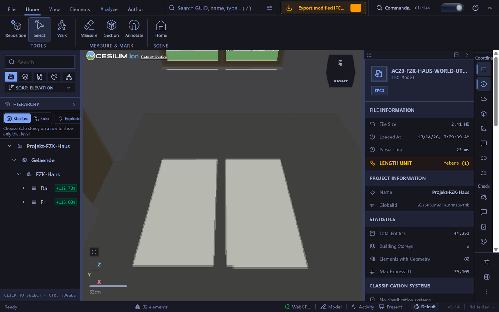
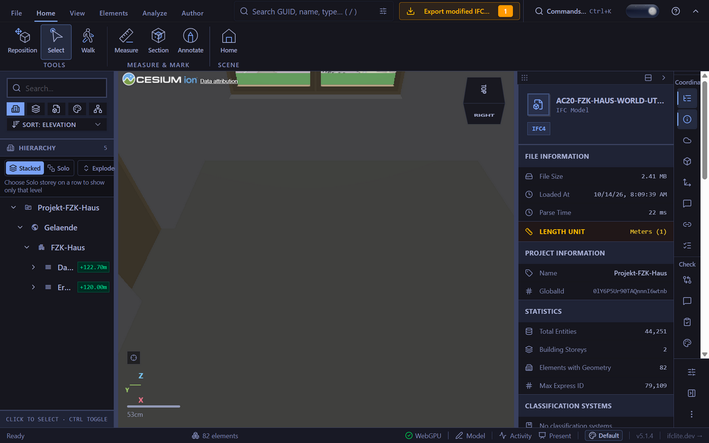

# World glazing shadow control (#7562)

The World viewer used one Cesium Model for opaque meshes and transparent glazing. With sun shadows enabled, both cast full depth: Cesium discards only zero-alpha translucent shadow fragments. The fix groups separate casting and receiving-only models under one native collection owner. It shares the WebGPU renderer's existing material casting floor, `DEFAULT_MIN_CAST_ALPHA` (0.9), before X-Ray styling.

## Actual native browser observation

T3's native Windows browser rendered the public Archicad `AC20-FZK-Haus.ifc` geometry through Cesium on ANGLE / NVIDIA RTX 5070 Ti / D3D11, DPR 1.5. The fixture loaded 317 meshes and 82 geometric entities. Window #23024 (`EG-Fenster-6`) had two glass meshes at alpha 0.1215686 and five opaque meshes. These are actual browser observations, not mocked drawing results.

The source candidate was based on main `d02a6bec`; the screenshots show viewer 5.1.4. The same qualified production/test blobs are carried onto current main for the PR. Fresh current-head CI remains required.

Camera `[3.8, 2.2, -7.5]`, target `[1.9, 0, -7.5]`, FOV 1.1; date `2026-06-21T16:00:00Z`; measured sun altitude 31.732°, azimuth 270.021°. The declared OrthogonalHeight was adjusted through the normal georeference setter to 120 m, above the local DEM (117 m), so camera clamping did not lift the interior camera through the roof. This is a controlled placement, not an assertion of the original authoring height.

- Candidate modes `[ENABLED, RECEIVE_ONLY]` (`[1,3]`): two window-shaped bright floor patches, with an opaque mullion shadow between them.
- Genuine public-API inverse: change only the glass child's `shadows` to `ENABLED`, yielding `[1,1]`. Both patches disappear at the same camera and sun.
- Restore the owner's `shadows = ENABLED`: `[1,3]` and both patches return.
- Canonically hide whole window #23024: its frame and glass disappear, and the two patches become one wider patch. Show it again: a replacement logical owner restores the frame, `[1,3]` and two patches.
- Turn shadows off through the normal solar setting: modes `[0,0]`, shadow map disabled, and the floor and walls become bright.

The two committed PNGs are the original product captures, copied without cropping, scaling or annotation:





At fixed 9×9 pixel regions centered at `(450,540)` and `(650,540)`, RGB was `[183,184,176]` in the candidate and restore, versus `[64,64,62]` in the inverse. The mullion `(568,540)` and unlit floor `(810,540)` stayed `[64,64,62]` in all three; wall `(860,280)` stayed `[67,67,69]`. These measurements read the original PNG pixels; no replacement images were generated.

## Georeference-only public fixture recipe

The original fixture SHA-256 is `ea6f04eaf92fac4d7ad0038bc3d2dfea4c094dd3f516ecc33c50bf1835ca108d` (2,526,544 bytes). The legacy IfcSite fallback is intentionally excluded from World. Keep every original byte and insert only these records immediately before the DATA section's final `ENDSEC;`:

```step
#79108= IFCPROJECTEDCRS('EPSG:32632',$,'WGS84',$,'Transverse Mercator','32N',#13);
#79109= IFCMAPCONVERSION(#62,#79108,458870.0632856814,5438773.629049493,110.,1.,0.,1.);
```

Existing context #62 and metre unit #13 are reused; IDs are above the original maximum 79107. Existing `proj4` converted the source site's longitude 8.436539° and latitude 49.100435° to UTM zone 32N; reverse conversion agreed within 1e-9 degrees. This adds legitimate placement metadata without altering authored geometry, identity or style. The derivative SHA-256 is `e22dae8713974162acec5d4c5ff73420ddb6f39fa89a094e83072653ffd530ad`. Then use the normal georeference editor/setter for the documented H120 camera-clearance adjustment.

For a controlled two-model case, preserve the actual canonical alignment refusals: both an absent vertical datum and an arbitrary named shared frame remain unknown. The separate QA pair explicitly assigns the recognized `VerticalDatum = 'EPSG:7837'`, H120 for both, with the second Eastings 30 m larger. This is an assumed QA test datum, not a claim about the author's original datum or surveyed height. Load the anchor and add the second through the ordinary file input/canonical loader. The two-model outcome is recorded only after an actual successful aligned load and rendering controls.

No IFC binary is committed here. The original public fixture remains unchanged. The reporter's model was not supplied, so this evidence qualifies the glazing-shadow defect class on authored geometry and does not identify the exact model in the issue screenshot.
