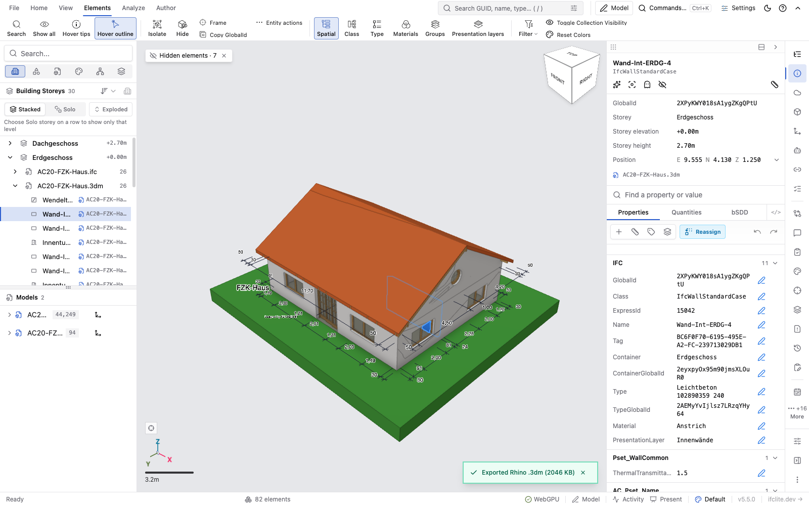
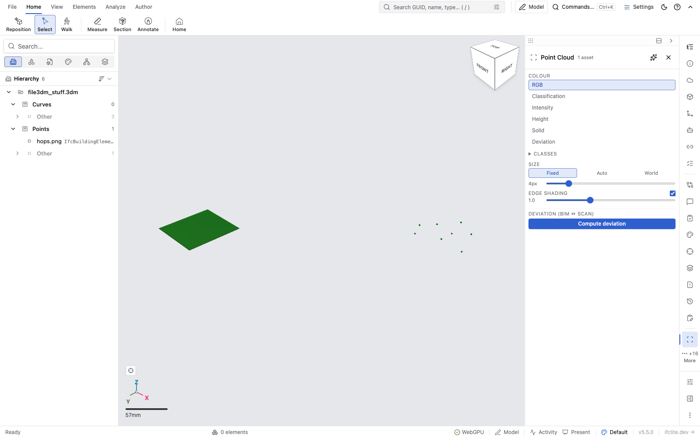
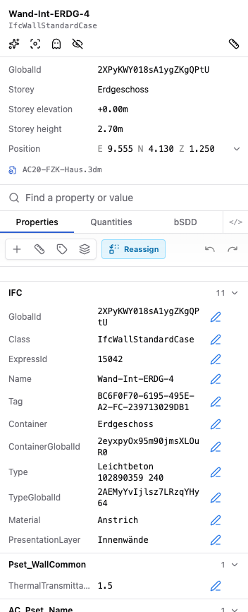

# Rhino .3dm

ifc-lite opens Rhino `.3dm` files in the viewer and federates them beside IFC models,
point clouds and LandXML. A `.3dm` is **read-only**: you can look at it, select objects,
read their properties and filter them, but nothing writes back to the file.

If the `.3dm` was written by ifc-lite's own [Rhino export](cli.md#rhino-export-options),
the IFC identity comes back with it. Every object keeps the GlobalId, class and
properties of the element it was exported from, so the re-imported model lands exactly on
the IFC it came from.

## Opening a file

Drop a `.3dm` into the viewer, pick it with Open, or add it with Add Model. It goes
through the same load path as every other format, so federation, selection, search, the
hierarchy panel and the properties panel all work the same way.

The format is decided by the file's first 24 bytes, not by its name. An IFC saved as
`model.3dm` is read as the IFC it is.

Archives up to and including Rhino 8 are read. A file saved by a newer Rhino is refused
with a message saying to save it as Rhino 8 or older. Rhino 9 has not been tested.

Parsing runs in a worker, so the viewport stays responsive, and the 2.7 MB Rhino runtime
is fetched only when you first open a `.3dm` or export one.

## What comes across

| In Rhino | In ifc-lite |
|---|---|
| Meshes | drawn as they are, quads split into triangles |
| Surfaces, polysurfaces and extrusions | drawn from the render meshes Rhino saved with the file |
| SubD | drawn from the control net, subdivided twice. An approximation of the limit surface |
| Point clouds | drawn, with per-point colours when the file has them |
| Block instances | drawn, baked into place |
| Object and layer colours, and material colour and transparency | the object's colour in the viewer |
| Layers | the hierarchy tree, nested as in Rhino |
| A layer switched off, or an object hidden | starts hidden, and the tree's eye shows it again |
| Attribute User Text | property sets on the object |
| Document user text | the model metadata panel |

Rhino facts the reader derives go into a property set called `Rhino`: the object's full
layer path, its Rhino object type, its UUID and its material name.

## Choosing the IFC class and identity in Rhino

An object with no `IFC::Class` is imported as `IfcBuildingElementProxy`. To import your
Rhino geometry as real IFC elements, set the class yourself in **Properties > Attribute
User Text** (or with the `UserText` command):

| Key | Value | Effect |
|---|---|---|
| `IFC::Class` | `IfcWall`, `IfcSlab`, `IfcDoor`, … | the object's IFC class |
| `IFC::GlobalId` | a 22-character IFC GUID | the object's identity, so it matches the same element in an IFC model |
| `IFC::Name` | any text | the object's name |
| `IFC::Description`, `IFC::ObjectType` | any text | the matching IFC attribute |

`IFC::Class` has to name a class that can be instantiated, from IFC2X3, IFC4 or IFC4X3,
and it has to be a product (something that can be placed in a building). A name that is
not one of those falls back to `IfcBuildingElementProxy`, and the value you wrote stays
visible in the object's `IFC` property set so you can see what was rejected.

Keys are matched ignoring case, so `ifc::class` works too.

Any other key is sorted by its prefix. `Pset_WallCommon::FireRating` becomes property
`FireRating` in set `Pset_WallCommon`. A key with no `::`, a key with an empty set or
property name, and any `Rhino::` key go into a set called `Attribute User Text`, under the
whole key.

Attribute User Text is text only, so every imported property is a string. Numbers are not
guessed.

### Several objects for one element

When ifc-lite exports an IFC element that has several pieces, it writes each piece as its
own Rhino object and puts them in a Rhino group named after the element's GlobalId. On
import those pieces come back as one element again.

The group is what does it. Two objects that merely carry the same `IFC::GlobalId`, with no
group named that GlobalId around them, are two elements: the second gets an identity of
its own and the file reports it. That is deliberate, because copying an object in Rhino
copies its Attribute User Text with it.

### Spatial structure

ifc-lite's export also stamps `IFC::GlobalId`, `IFC::Class` and `IFC::Elevation` on the
layers that stand for the project, site, building and storeys. The import reads those
stamps and rebuilds the spatial tree, with the source IFC's own identities and storey
elevations, so the storey filter, the exploded view and storey-based sections work on a
re-imported model.

You can stamp layers yourself in Rhino, under **Layer Properties > User Text**, with the
same keys. An unstamped layer inside a stamped structure gets no row of its own: its
objects appear under the nearest stamped layer above it. An unstamped layer outside every
stamped structure keeps its own row, unless it holds no object anywhere under it.

A file with no stamps at all gets a tree of its Rhino layers instead, each one an
`IfcSpatialZone`, which keeps them out of the storey tools a file without storeys has no
storeys for.

## What is not imported yet

- **Block instances are baked.** Each placement arrives as its own geometry rather than as
  an instance of a shared definition, so a file with many repeated blocks costs more
  memory than it needs to.
- **Curves and text dots are read but not drawn.** They cross into the viewer and are
  counted, and a file whose only drawable objects are curves is refused with "Nothing in
  this file can be drawn".
- **Rhino's earth anchor is reported, never applied.** It shows in the model metadata and
  the geometry is not moved by it, so a Rhino file that is not an ifc-lite export does not
  align itself with a georeferenced IFC. ifc-lite's own exports align exactly, through the
  frame the export records.
- **No CLI or MCP reading.** `.3dm` opens in the viewer only.

## Limits

- **400 MB per file.** Above that the file is refused with its size and the cap. The limit
  is the Rhino runtime's 2 GB memory, not a policy.
- **Surfaces need their render meshes.** Rhino stores them with the file when you save
  from a shaded view without "Save Small". A surface saved without one cannot be drawn and
  is counted as skipped, with the remedy in the message.
- **Deviation and 2D outlines of a point cloud far from the origin are coarse.** The cloud
  itself is drawn and picked at full precision, because its origin is kept at double
  precision. The deviation analysis and the traced 2D scan outline still work at single
  precision, so at map-scale coordinates (thousands of kilometres) they can be off by
  centimetres or more
  ([#10094](https://github.com/LTplus-AG/ifc-lite/issues/10094)).
- **With a second model loaded, a hidden object's row is out of reach.** The tree then
  lists unified storeys and model rows, not each object of the `.3dm`, so the eye on a
  hidden object's own row is only there while the `.3dm` is the one loaded model.
- **A loaded `.3dm` cannot be exported as IFC STEP.** There are no STEP records behind it,
  so the export dialog refuses and says so. IFCX, glTF, CSV and the other content exports
  work normally.
- **Locked layers and locked objects are ignored**, since the viewer is read-only anyway.
- **Linked block files are not followed.** Their geometry is not in the `.3dm`.

## When a file is refused

| What you see | What happened |
|---|---|
| "Not a Rhino .3dm file, or the file is damaged." | the file starts like a Rhino archive but is incomplete or corrupt |
| "This file was saved by a newer Rhino…" | the archive version is above Rhino 8 |
| "This file is … ; the reader handles up to 400 MB." | over the size cap |
| "…could not be read: it most likely needs more memory than the reader has." | the Rhino runtime ran out of memory part-way through |
| "Nothing in this file can be drawn…" | nothing in the file produced geometry; the message lists what was skipped |

A refusal leaves everything already loaded alone. Dismiss the message and carry on.

## See also

- [Exporting an IFC model to `.3dm`](cli.md#rhino-export-options)
- [IFC to Rhino .3dm export](../architecture/rhino-3dm-export.md), the export contract
- [Rhino .3dm import](../architecture/rhino-3dm-import.md), the import contract and what
  each claim rests on
