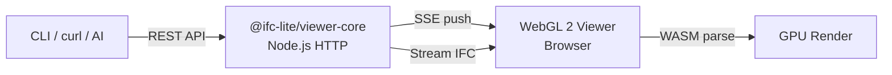

# 3D Viewer & Analysis

The `view` and `analyze` commands turn the CLI into a visual BIM analysis tool. Launch an interactive WebGL 2 viewer in the browser, then drive it from the terminal, scripts, or AI assistants via a REST API.

!!! info "Viewer package"
    The viewer is provided by `@ifc-lite/viewer-core`, which installs with the CLI.

## `view` — Launch 3D Viewer

```bash
# Open a model in the browser
ifc-lite view model.ifc

# Fixed port (useful for scripting)
ifc-lite view model.ifc --port 3456

# Don't auto-open the browser
ifc-lite view model.ifc --port 3456 --no-open

# Empty scene — build geometry via API
ifc-lite view --empty --port 3456
```

**Flags:**

| Flag | Description |
|------|-------------|
| `--port <N>` | Listen on a specific port (default: random) |
| `--no-open` | Don't open the browser automatically |
| `--empty` | Start with an empty scene (no IFC file) |
| `--send <json>` | Send a command to an already-running viewer (requires `--port`) |

### Interactive Console

While the viewer is running, type commands directly in the terminal:

```
colorize IfcWall red        # Color all walls red
isolate IfcWall IfcSlab     # Show only walls and slabs
xray IfcWall 0.15           # Make walls transparent
highlight 42 43             # Highlight entities by express ID
flyto IfcDoor               # Fly camera to doors
view front                  # Switch to front view
storey                      # Color by height bands (approximate storeys)
section y center            # Add horizontal section plane
clearSection                # Remove section plane
clear                       # Remove live-created geometry
showall                     # Show all entities
reset                       # Reset colors and visibility
quit                        # Stop the viewer (also exit, q)
```

`flyto` also takes an express ID (`flyto 42`). Any other line is parsed as a JSON command and sent as-is.

Console named colors: `red`, `green`, `blue`, `yellow`, `orange`, `purple`, `cyan`, `white`, `pink`. An unknown name falls back to red.

### Send Commands from Another Terminal

Use `--send` to control a running viewer without opening a new one:

```bash
ifc-lite view --port 3456 --send '{"action":"colorize","type":"IfcWall","color":[1,0,0,1]}'
ifc-lite view --port 3456 --send '{"action":"setView","view":"top"}'
ifc-lite view --port 3456 --send '{"action":"isolate","types":["IfcWall","IfcSlab"]}'
```

---

## REST API

The viewer exposes a REST API on the same port. Use it from `curl`, scripts, or AI tools.

### `POST /api/command` — Send Viewer Commands

```bash
curl -X POST http://127.0.0.1:3456/api/command \
  -H 'Content-Type: application/json' \
  -d '{"action":"colorize","type":"IfcWall","color":[1,0,0,1]}'
```

Returns `{"ok": true, "action": "colorize", "clients": 1}` on success.

#### Type-Level Actions

These operate on all entities of a given IFC type:

| Action | Payload | Description |
|--------|---------|-------------|
| `colorize` | `{type, color}` | Color all entities of a type. `color` is `[r,g,b,a]` (0-1) or a named color (`red`, `green`, `blue`, `yellow`, `orange`, `purple`, `cyan`, `white`, `pink`, `gray`) |
| `isolate` | `{types: [...]}` | Ghost every entity not of a listed type |
| `xray` | `{type, opacity?}` | Make a type semi-transparent |
| `flyto` | `{type}` or `{ids}` | Fly camera to a type or to express IDs |
| `highlight` | `{ids: [...]}` | Highlight express IDs |
| `colorByStorey` | `{}` | Color by height bands (3 to 10 bands over the model's vertical extent); it does not read `IfcBuildingStorey` |
| `setView` | `{view}` | Set camera: `front`, `back`, `left`, `right`, `top`, `bottom`, `iso` |
| `showall` | `{}` | Clear all color, hide and ghost overrides |
| `reset` | `{}` | Like `showall`, and also clears the section plane and refits the camera |

#### Entity-Level Actions

These operate on specific express IDs:

| Action | Payload | Description |
|--------|---------|-------------|
| `colorizeEntities` | `{ids, color}` | Color specific entities |
| `isolateEntities` | `{ids}` | Ghost every entity not listed |
| `hideEntities` | `{ids}` | Hide specific entities |
| `showEntities` | `{ids}` | Show previously hidden entities (also clears their color override) |
| `resetColorEntities` | `{ids}` | Reset colors on specific entities |
| `selectEntities` | `{ids}` | Show the pick info of the first listed entity the viewer holds |

#### Section Planes

| Action | Payload | Description |
|--------|---------|-------------|
| `section` | `{axis, position}` | Add section plane. Axis: `x`, `y`, or `z`. Position: number, `"center"`, or `"50%"` |
| `clearSection` | `{}` | Remove section plane |

#### Camera

| Action | Payload | Description |
|--------|---------|-------------|
| `camera` | `{state: {position?, target?}}` | Move the camera to a position and target (sent by the SDK's `bim.viewer.setCamera`) |

Three more actions are accepted for the viewer's own use: `addGeometry` (sent by `/api/create`), `removeCreated` (sent by `/api/clear-created`) and `picked` (the browser reports a click back).

### `POST /api/create` — Live Element Creation

Create IFC elements and inject them into the viewer in real time. Accepts a single object or an array for batch creation.

```bash
# Single element
curl -X POST http://127.0.0.1:3456/api/create \
  -H 'Content-Type: application/json' \
  -d '{"type":"wall","params":{"Height":3,"Start":[0,0,0],"End":[5,0,0]}}'

# Batch create (single HTTP call)
curl -X POST http://127.0.0.1:3456/api/create \
  -H 'Content-Type: application/json' \
  -d '[
    {"type":"wall","params":{"Height":3,"Start":[0,0,0],"End":[5,0,0]}},
    {"type":"wall","params":{"Height":3,"Start":[5,0,0],"End":[5,5,0]}},
    {"type":"slab","params":{"Width":5,"Depth":5}}
  ]'
```

Each element may also carry `storey` and `project` names; the first element's values name the storey (default `Created`) and project (default `Live Edit`) for the whole call. Returns entity list and IFC size:

```json
{"ok":true,"count":3,"entities":[...],"ifcSize":3646}
```

All 29 element types from the [`create` command](cli.md#create-create-ifc-files) are supported. Coordinates use IFC Z-up convention.

### `POST /api/clear-created` — Remove Live Geometry

```bash
curl -X POST http://127.0.0.1:3456/api/clear-created
```

Hides all geometry added via `/api/create` in the viewer, clears it from server state, and returns `{"ok":true,"cleared":N}`.

### `GET /api/export` — Download Created Geometry

```bash
curl http://127.0.0.1:3456/api/export > created.ifc
```

Downloads the geometry from every `/api/create` call. Each call is its own complete IFC STEP file, and the export joins them with newlines, so after more than one call the download holds several STEP files back to back. With nothing created it returns `{"ok":false,"error":"No geometry has been created yet"}`. Geometry sent with `ifc-lite create --viewer` goes straight to the browser and is not included.

### `GET /api/status` — Server Status

```bash
curl http://127.0.0.1:3456/api/status
```

```json
{"ok":true,"model":"Building.ifc","clients":1,"createdSegments":2}
```

---

## `analyze` — Visual Analysis Overlay

Query entities by type and properties, then push the results as color overlays to a running viewer. Requires a viewer to be running first.

```bash
# Start the viewer
ifc-lite view model.ifc --port 3456 --no-open &

# Find walls missing fire rating — color them red
ifc-lite analyze model.ifc --viewer 3456 \
  --type IfcWall --missing "Pset_WallCommon.FireRating" --color red

# Heatmap by slab area
ifc-lite analyze model.ifc --viewer 3456 \
  --type IfcSlab --heatmap "Qto_SlabBaseQuantities.GrossArea" --palette blue-red

# Filter by property value
ifc-lite analyze model.ifc --viewer 3456 \
  --type IfcWall --where "Qto_WallBaseQuantities.GrossSideArea>50" --color orange

# Isolate + color + fly to
ifc-lite analyze model.ifc --viewer 3456 \
  --type IfcDoor --isolate --color green --flyto
```

**Flags:**

| Flag | Description |
|------|-------------|
| `--viewer <port>` | Port of the running viewer (**required**) |
| `--type <T>` | IFC type to analyze (e.g. `IfcWall`) |
| `--missing <Pset.Prop>` | Find entities missing a property |
| `--where <expr>` | Property or quantity filter with `>`, `<`, `>=`, `<=`, `=`, `!=`: `Pset.Prop>100`, `Pset.Prop=true`, or a bare quantity name (`GrossArea>100`). Replaces `--missing` when both are given |
| `--color <name>` | Color matched entities (named, including `gray`, or `r,g,b,a`; default red) |
| `--heatmap <Pset.Prop>` | Color by numeric value (gradient) |
| `--palette <name>` | Heatmap palette: `blue-red` (default), `green-red`, `rainbow` |
| `--isolate` | Ghost non-matching entities |
| `--flyto` | Fly camera to matched entities |
| `--name <text>` | Name of the single rule built from the flags |
| `--rules <file.json>` | Run multiple rules from a JSON file |
| `--json` | Machine-readable output |
| `--out <file>` | Write the results as JSON to a file |

### Rules File

Run multiple analysis rules in one pass using a JSON file:

```json
[
  {
    "name": "Missing fire rating",
    "type": "IfcWall",
    "missing": "Pset_WallCommon.FireRating",
    "color": "red",
    "isolate": true
  },
  {
    "name": "Large slabs",
    "type": "IfcSlab",
    "where": "Qto_SlabBaseQuantities.GrossArea>100",
    "color": "orange"
  },
  {
    "name": "Wall area heatmap",
    "type": "IfcWall",
    "heatmap": "Qto_WallBaseQuantities.GrossSideArea",
    "palette": "blue-red"
  }
]
```

```bash
ifc-lite analyze model.ifc --viewer 3456 --rules rules.json --json
```

### Stream `eval`, `run` and `create` to the Viewer

`eval`, `run` and `create` also take `--viewer <port>`. With it, `bim.viewer.*` and `bim.visibility.*` calls in `eval` and `run` update the running viewer, and `create` sends the new element to it (with `--viewer` and no `--out`, `create` fails if the viewer cannot be reached).

```bash
ifc-lite run color-walls.js model.ifc --viewer 3456
ifc-lite create wall --start 0,0,0 --end 5,0,0 --height 3 --thickness 0.2 --viewer 3456
```

---

## Coordinate Convention

IFC uses **Z-up**; the WebGL viewer uses **Y-up** internally. The WASM geometry engine handles the conversion automatically during mesh parsing. When using `/api/create`, pass coordinates in IFC Z-up convention (`[x, y, z]` where Z is vertical).

## Architecture



The viewer is a self-contained WebGL 2 application served as a single HTML page. Commands flow from external tools through the REST API, get broadcast to connected browsers via Server-Sent Events (SSE), and execute in the WebGL renderer.

Key design decisions:

- **IFC streamed from disk** — large models aren't buffered in Node.js memory
- **WASM geometry engine** — parsing and mesh generation happen in the browser
- **GPU color-ID picking** — click any entity to see its express ID and type
- **Per-vertex color buffer** — real-time colorization without re-uploading geometry
- **SSE with exponential backoff** — reconnects automatically if the connection drops
- **Loopback only**: the server listens on 127.0.0.1, answers only requests whose Host is `localhost`, `127.0.0.1` or `[::1]` (this blocks DNS rebinding), and refuses requests from pages served from anywhere else, including cross-site iframes and links (`Sec-Fetch-Site: cross-site`); a link to the viewer page, or an IDE preview pane that embeds it, still opens it; a `frame-ancestors` policy keeps other sites from framing it. Only the viewer's own page, pages opened as `localhost` or `127.0.0.1` (http or https), and preview panes in desktop VS Code-family editors such as VS Code and Cursor may embed it. For requests, any page served from a local port counts as local. A refusal is a 403 that names the failed check. CORS allows only those local origins. To reach the viewer from another machine, forward the port with an SSH tunnel and open it as `127.0.0.1` on your side. A viewer inside a container is not reachable from the host through a published port in this release.

## Programmatic Usage (`@ifc-lite/viewer-core`)

The viewer server can be used as a library in your own Node.js tools:

```typescript
import { startViewerServer } from '@ifc-lite/viewer-core';

const viewer = await startViewerServer({
  filePath: 'model.ifc',
  fileName: 'My Model',
  port: 3456,
  onReady: (port, url) => console.log(`Viewer at ${url}`),
});

// Send commands programmatically
viewer.broadcast({ action: 'colorize', type: 'IfcWall', color: [1, 0, 0, 1] });
viewer.broadcast({ action: 'setView', view: 'iso' });

// Check connected clients
console.log(`${viewer.clientCount()} browsers connected`);

// Clean up
viewer.close();
```

`/api/create` answers 501 unless you pass a `createHandler` in the options. `onError` receives server errors such as `EADDRINUSE`. The returned server also exposes `createdSegments`, the IFC text of each `/api/create` call.

**Exports:**

| Export | Description |
|--------|-------------|
| `startViewerServer(opts)` | Start the HTTP + SSE server |
| `VALID_ACTIONS` | `Set<string>` of accepted command actions |
| `getViewerHtml(modelName)` | Get the self-contained viewer HTML |
| `viewerUrl(port, path?)` | The server's own URL, `http://127.0.0.1:<port><path>`. Also available from `@ifc-lite/viewer-core/url`, which loads no server code |
| `createStreamingViewerAdapter(port)` | SDK adapter for `bim.viewer.*` calls |
| `createStreamingVisibilityAdapter(port)` | SDK adapter for visibility calls |
| `ViewerServer` | Server instance type |
| `CreateHandler` | Handler type for `/api/create` |
| `CreateResult`, `ViewerServerOptions` | Result and options types |
