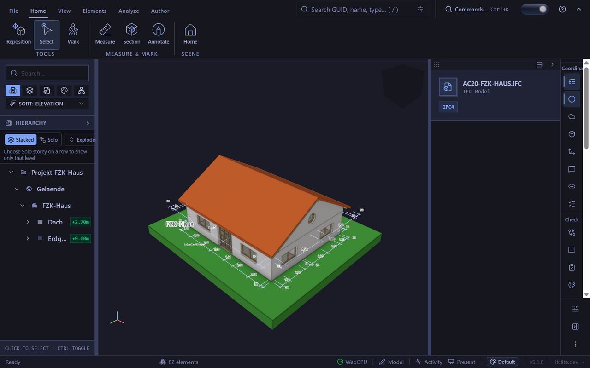
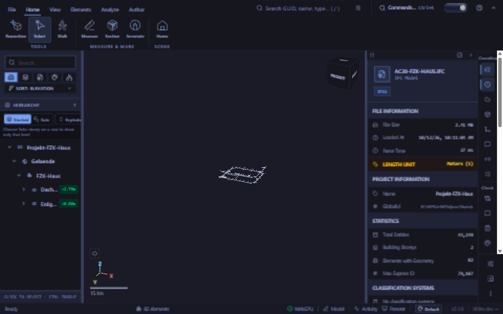
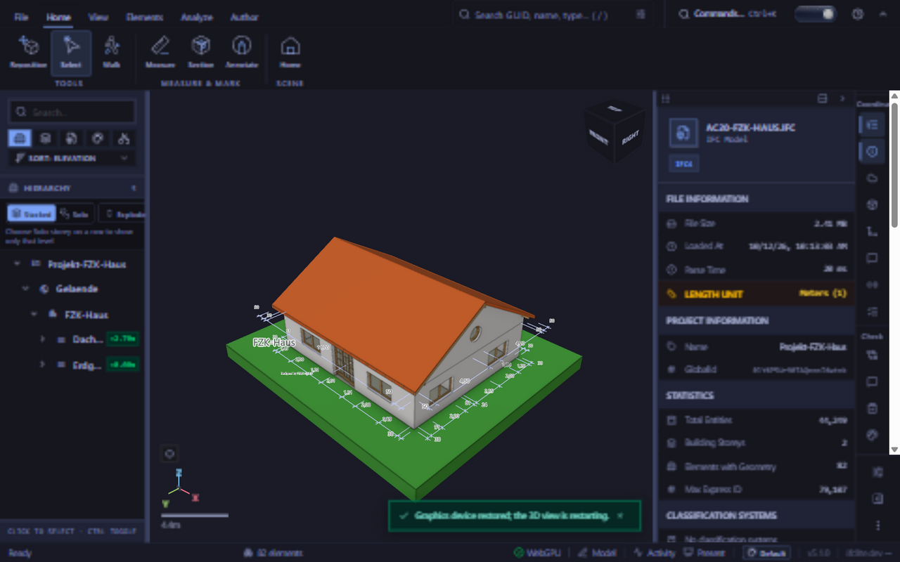

<!-- SPDX-License-Identifier: MPL-2.0 -->

# Geometry arrivals during GPU recovery (#6993 / folded #7164)

The exact base `90c40f410bc0fd5203a55892c013827d796624f9` replaces a lost
device, but the streaming hook does not observe that replacement. Source
geometry and instanced shards arriving during the gap remain absent when
their references stop changing. A stream ending during the gap also loses
its finalization transition. The candidate passes the existing recovery
epoch into those effects and preserves that transition until a device exists.

## Native qualification

Three production builds/runs used the T3 shared preview on Windows Chrome
with an NVIDIA Blackwell adapter: a healthy base control, base with controlled
loss, and candidate with the same loss. All loaded the public
`tests/models/ara3d/AC20-FZK-Haus.ifc` through `file-input-open` and the
canonical viewer loader. Fixture SHA-256:
`d42ab0dee01173106c16cd823b4614efe188fa15dd65195d95b9879bec59acc5`.
All used the same WASM runtime, SHA-256
`3912d1046cf6507e7ef6f85a0492a0e54fbb31ae711b85c6e46b6313ffd63312`.
Default timed uploads, four workers with batch bounds 64/64, and mesh cache
disabled were used. This is a recovery correctness experiment, not a benchmark.

[injection.js](injection.js) wraps native device creation. After the renderer
publishes its diagnostics it destroys the first real device, reports a
controlled unknown loss to the normal health subscriber, and holds the
replacement request until release (with a bounded timeout). It neither injects
geometry nor bypasses the canonical load path. Both forced runs completed
geometry and parser work while replacement was held: 275 source meshes and
zero GPU geometry. Each then obtained one replacement device.

| Run | Resident geometry bytes | Draw calls | Rendered owners | Successful finalization |
| --- | ---: | ---: | ---: | ---: |
| Healthy base control | 658488 | 19 | 83 | 1 |
| Base after replacement | 0 | 0 | 0 | 0 |
| Candidate after replacement | 658488 | 19 | 83 | 1 |

The control and candidate retain 15 flat batches and four instanced batches.
All three have the same CPU source geometry hash, covering mesh ids, model and
item ownership, colors and positions/normals/indices. The healthy control and
candidate also share the rendered-owner hash, which normalizes world-space
indexed triangles, colors, model ownership and source triangle ordinals.
It is geometry/appearance identity, not literal GPU-buffer or pixel identity.
The real screenshots and full measurements are retained in [native.json](native.json).
The hash collector is [identity.js](identity.js); source owners and build
provenance are retained in [source-binding.json](source-binding.json).

Healthy control:

Base after recovery, with parsed hierarchy but absent house geometry:

Candidate after the same controlled loss:

The hidden-tab healthy control had a delayed animation-frame finalization;
its wall time is not comparable to the visible forced runs. Both forced runs
are contaminated by device loss and replacement. No latency or throughput
claim is made. The experiment does not establish why the original unforced
SwiftShader device was lost, nor claim that cause is fixed.

## Regression and inverse qualification

Mounted hook tests use the real Scene upload/ownership implementation, with
GPU allocation stubs and an encoded IFNS triangle. They exercise arrivals
during loss, missed stream completion, already-owned geometry, and pending
instances in one-model and two-model store configurations. Federated ids use the canonical
store resolver. The existing instanced tests share the same binary fixture.

The five focused cases pass on the candidate. Restoring all three production
owners to the exact base produces four assertion failures and one passing
already-owned control, with no skips. Restoring the candidate passes all five
again. The original `inverse.json` and text logs are retained byte-for-byte in
[historical-regressions.zip](historical-regressions.zip), with member digests in
[historical-regressions.json](historical-regressions.json). The complete geometry-streaming
cohort passes 27 cases. An earlier fixture iteration threw on a minimal
renderer stub missing `getPipeline`; that infrastructure error is excluded
from the inverse count. The finalization guard only requires a live device. A later fixture expansion
initially populated store models without registering their offsets; its
federated assertion failure is also excluded. The qualified fixture registers
model offsets and derives its maps and expected ids through the canonical paths.

The type interface extraction lowers the hook's module budget; no module
budget is raised. The issue remains open for its original device lifetime
investigation; forced-loss evidence cannot qualify an uncontaminated run.

## Review extension

Review found the same gap in the queued translation and rotation drains.
The expanded mounted fixture also reproduced missing overlay colours,
removals and in-place remeshed slots on initial candidate `9daa20b58f`:
five assertion failures and six passing cases. The existing epoch now reaches
all those drains, including the extracted edit and overlay hooks. Eleven
focused cases pass; reverting all five production owners to the exact base
causes ten assertion failures and one passing existing-geometry control.
Restoration passes all eleven. The expanded geometry/edit/overlay cohort
passes 42 cases without skips, and full root typecheck and lint pass again.
The original receipts above remain historical evidence;
`review-inverse.json`, its text logs and `review-checks.json` qualify that
expanded source inside the same historical archive.

A further canonical native GPU run uses these current production owners and
matches the original healthy control's CPU source and rendered-owner hashes,
resident bytes and draw counts after one loss and replacement. Source
completion precedes replacement creation. Its bounded hold automatically
released after twenty seconds; the late during-gap observation failed and is
excluded, rather than being reported as a successful observation. Full data,
current owner hashes and the observed rendered house are retained in
[review-native.json](review-native.json),
[review-source-binding.json](review-source-binding.json) and
[the post-review screenshot](review-candidate-recovered.png).
The large native JSON cohorts are compacted without changing any values.
This remains correctness evidence with no timing claim or original-root-cause
claim.

## Placement and finalization retry phases

The second review exposed two real cases missed by the null-device fixture.
On `dcdb10d25`, a recovery epoch cancelled the pending queue-drain finalizer,
while non-null-device upload failure replayed an already-applied CPU placement.
Three new real-Scene assertions fail on that head. Finalization now retains
its pending transition until completion, and cleanup prevents an old attempt
from settling a newer transition. A shared placement drain consumes each CPU
delta once and retains only the GPU rebuild stage for retry. The real store's
merged-edit control confirms a later move adds only its new delta, even while
uploads keep failing.

The current focused cohort passes 15 cases. Exact-base rollback of all six
production owners yields 13 assertion failures and two controls; restoration
passes all 15. The queue-drain cancellation case is one of the passing base
controls: the base did not observe epochs, so it did not introduce this new
cancellation. Its failure is specifically reproduced on the intermediate head.
[phase-inverse.json](phase-inverse.json) and the readable failure log retain
these results; the passing before/restored logs remain byte-for-byte in the
historical archive; [phase-checks.json](phase-checks.json) records the full geometry/edit/
overlay cohort (46 passing cases), root typecheck and lint, and repository gates.
The helper extraction lowers the hook's budget again.

A further current-source native FZK run captures source completion during the
held recovery gap: 275 source meshes and zero GPU geometry. After release,
CPU source and rendered-owner hashes, resident bytes and draw counts match the
original healthy exact-base control. Data and source ownership are retained in
[phase-native.json](phase-native.json),
[phase-source-binding.json](phase-source-binding.json) and
[the current recovered house](phase-candidate-recovered.png). A missing stored
collector and then a trailing-newline validation error delayed the post-recovery
collection; the observed during-gap capture was retained, and the corrected
collector subsequently qualified the same completed run. These tooling errors
are not counted as behavioral assertions or successful collections.
