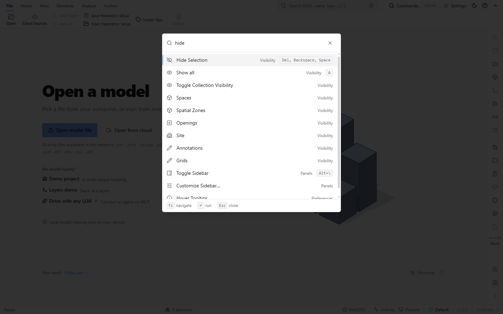
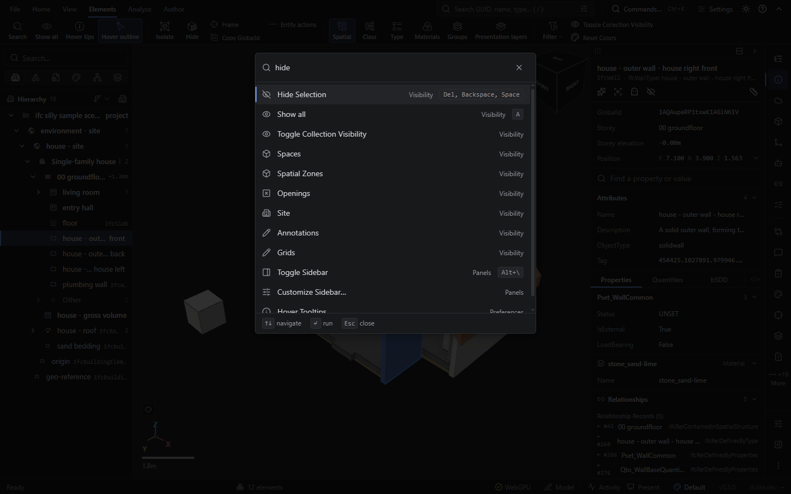
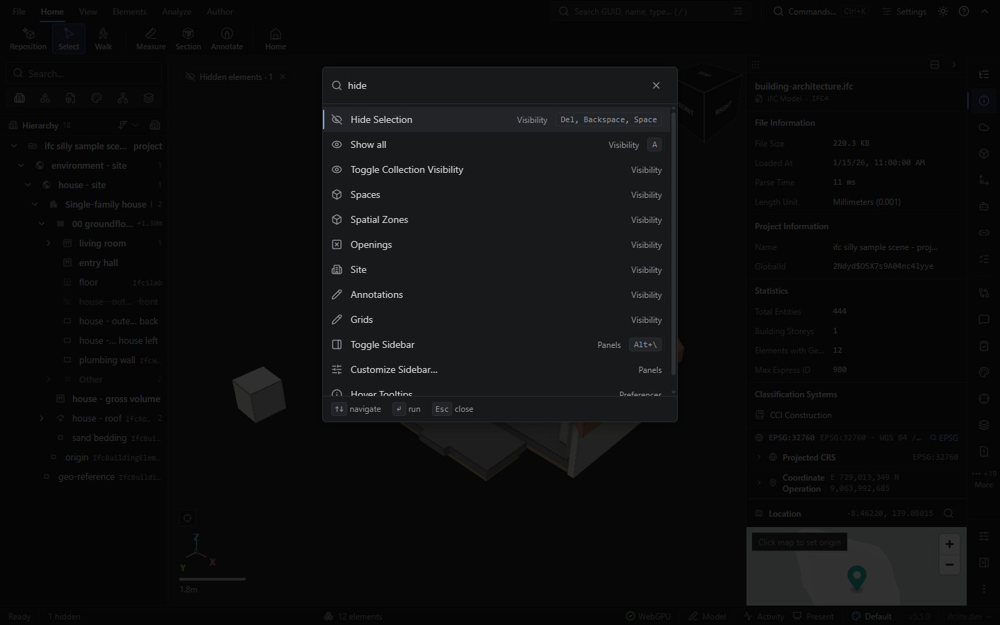
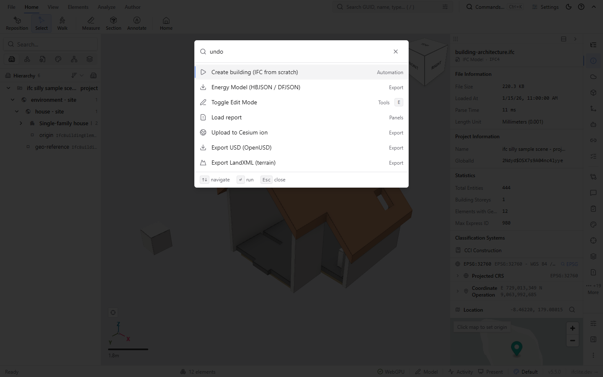
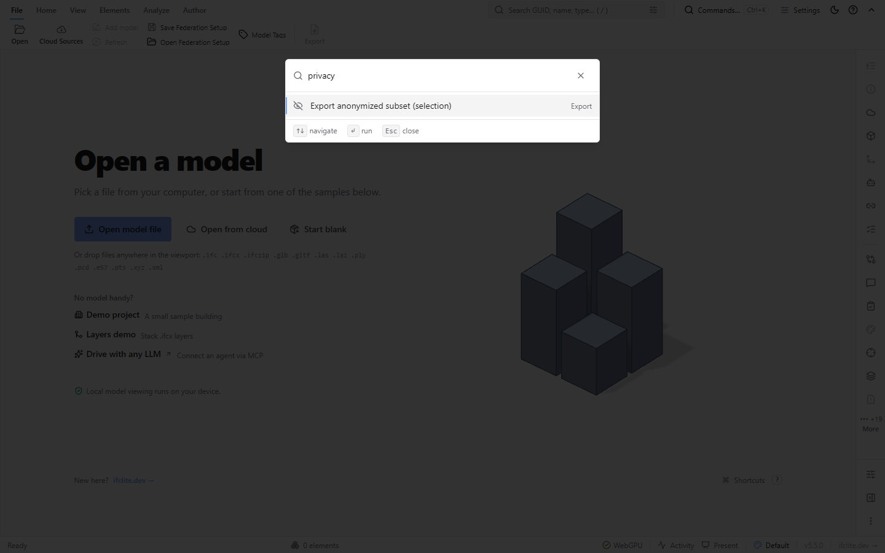
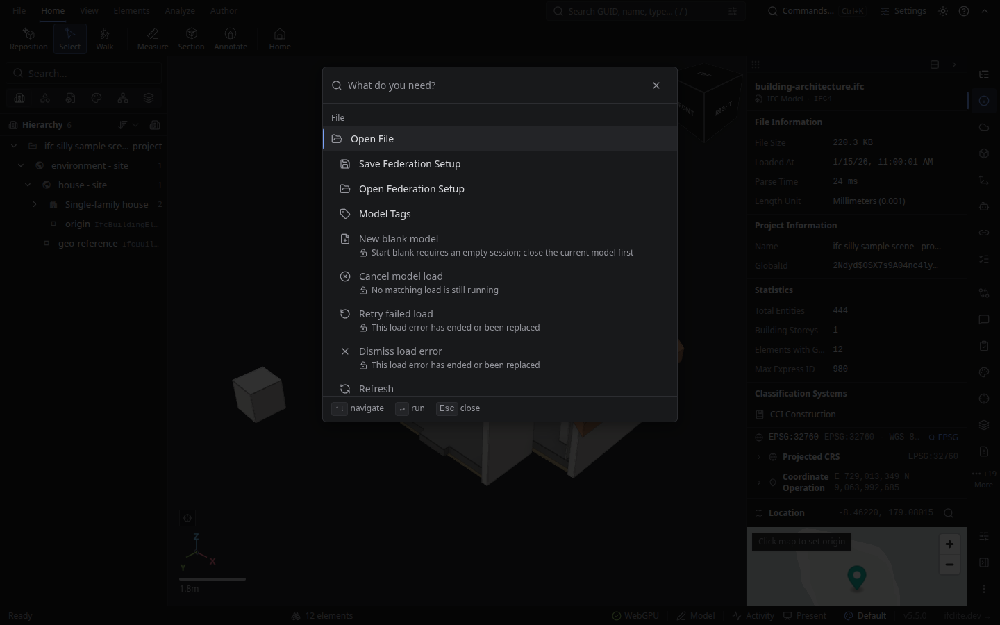
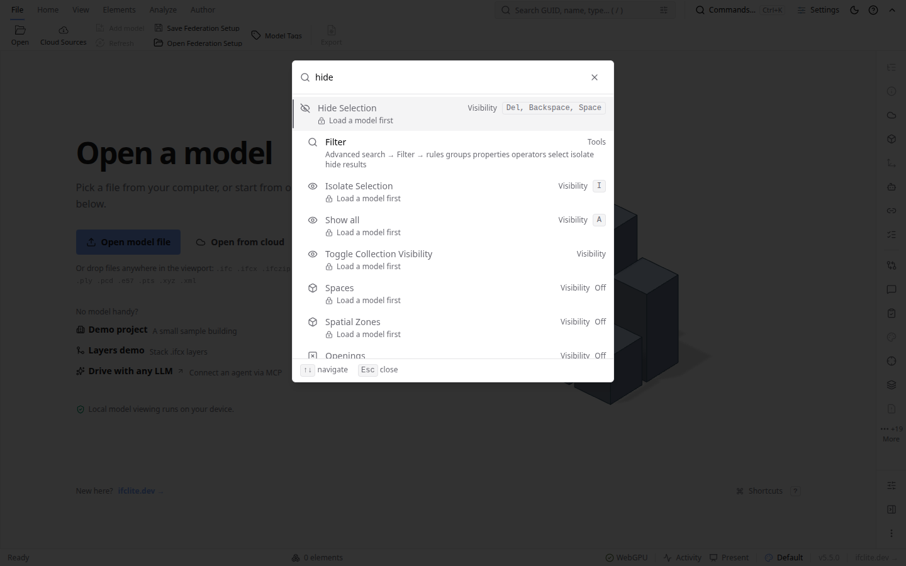

# Complete command-palette feature access — #8947

This is a separate hillclimb from the accepted general UX in #8946 / PR #8950.
Maximum eight review rounds. No numerical taste score proves completeness.

## Goal and boundary

Every user-facing viewer feature, tool and action must be reachable by a functioning
palette action or a clearly named destination opening its real flow. Use canonical
registry actions and existing tool hosts. A destination must disclose its child
path; simply opening a parent panel does not establish access to every child.
Include ribbon, menus, panels, contextual actions, modeling, settings, exports,
extensions, runtime commands, recovery controls and keyboard-only capabilities.
Record duplicate entry points and display-only controls explicitly.

The access contract ends at real configuration/review/launch controls. It does not
require publishing remote changes or spending money to exercise every parameter.
Applicable prerequisites, cancellation and unavailable/error recovery must work.
Preserve file-picker user activation, canonical model loading and selection channels.

## Independent baseline and evidence

Accepted UX source: `9d476f01e7b2bfc1e69799d39a1b0289d6a6e2d3`, tree
`63f8396b08b2271c02364336e14f8f8acd0b41a4`. Parent branch adds documentation only.
The UX screenshots establish inherited presentation, not feature coverage.
Source preparation identified 39 registry omissions and additional modeling/subflow
gaps. All source-connected mappings start unverified until behavior is observed.
The inventory must retain source control, canonical action, palette ID, ordered
child controls, aliases, prerequisites, observation and remaining gap for each row.

Required contexts: unloaded; loaded without selection; loaded with selection.
Cross applicable rows with single/federated model, renderer/property selection,
editable/read-only role, installed/enabled/disabled/missing extension, and conditional
modules. Use real bundled IFC or parsed STEP fixtures. Explicitly mark unavailable
hardware/provider/build contexts; do not count skipped scenarios as passed.

## Frozen rubric and vetoes

1. Inventory completeness: every source capability maps or has a stated exclusion.
2. Functioning destination: exact canonical flow and named child controls are reachable.
3. Task-language search: clear aliases find the intended action without misleading labels.
4. Context truth: prerequisites and remedies remain visible and update live.
5. Keyboard and grouping: readable labels, discoverable disabled rows, stable focus/selection.
6. UX preservation: accepted #8946 interactions and layout remain intact.

Missing capability, broken destination, silent no-op, stale eligibility execution,
file-picker activation loss or accepted-UX regression veto completion. Fresh Opus
judges taste, Astra reviews reasoning, Codex implements. No competing source writers.
Each round records source, changes, independent objections, test receipts, visual
and behavioral evidence, accept/reject decision and remaining gaps separately.

| Round | Status | Changes / hypothesis | Evidence / verdict |
| --- | --- | --- | --- |
| 1 | REVISE (provisional source `8021801`) | Unified projection, prerequisites and canonical destinations | 12/12 GPU context captures, no page errors; Opus found command labels clipped by reasons and unavailable rows styled as runnable. Full access unaccepted. |
| 2 | REVISE (observed UX, source `f8ca13e`) | Preserve labels above explanations; distinguish blocked rows and suppress Run hint; close eligible-report route and discovery gaps | 36/36 physical-GPU captures, zero page errors; browser 21/22 with extension calibration correction pending. Opus confirms R1 fixes, finds 12px selected-row misalignment and inactive recovery rows crowding browse. Overall coverage remains unaccepted. |
| 3 | Observed UX ACCEPT; complete access pending | Aligned labels, contextual recovery browse, honest replaced-error reasons and narrow wrapping | Opus accepted pinned `15bd492`: 22/22 physical-GPU browser cases, 36/36 captures, 401/401 focused tests. Full four-shard, integrated-main workflow tests and inventory closure remain pending. |

Implementation batches inside a round are not separate acceptance rounds. Keep
reviewable PR layers for #8947 if the implementation exceeds roughly 1500 lines.
Release requires full root Turbo coverage, real UI evidence, post-commit pre-handoff,
required CI and resolved reviews. Mergify only, after base is main. Parent handles
watching and production verification; never claim a merge is a deployment.

## Reproducible context captures

`capture-contexts.mjs` extends the existing real-model GPU capture protocol. Freeze
its six scenes for this campaign and run them against both accepted baseline and
candidate artifacts, in light and dark. The selected fixture is an actual parsed
wall from `/samples/building-architecture.ifc`; setup uses the canonical renderer
selection action. The execution scene clicks the actual Hide Selection option and
requires that the selected wall enters the renderer hidden set before capture.
Other scenes record command labels, availability, selection and context without
asserting that a known baseline omission is correct. Observations are not coverage
credit for unvisited child tools.

```sh
~/build-workers/ifc-gpu-check --limit 10 -- bash -c '
  node tests/ui-scenes/command-palette-access/capture-contexts.mjs \
    --dist "$PALETTE_DIST" --out "$PALETTE_EVIDENCE" --label "$PALETTE_SOURCE" \
    --scenes access-unloaded-hide,access-loaded-hide,access-selected-hide,access-selected-hide-run,access-history,access-settings-privacy \
    --themes light,dark --cdp "$IFC_GPU_CDP_URL"
'
```

Set the three `PALETTE_*` variables to the exact-tree verified built artifact,
owned evidence directory and source identity; export them for the runner. This
is bounded correctness evidence, not a performance benchmark. The helper closes
its own pages and preview server. Preserve `context-observations.json`, image
hashes and `manifest.json`; record failures and never count absent captures as a
pass. Release regenerable downloads after their evidence and all uses settle.

## Baseline observations (accepted UX source, separate access judgment)

Twelve captures passed on the matching `9d476f01` artifact, using the real NVIDIA
GPU and public IFC fixture; zero scene failures or page errors. The same action
shows **Hide Selection enabled with no explanation** both unloaded and loaded
without selection. Selecting the parsed wall (global ID 262 in this single-model
fixture) then clicking Hide Selection actually hides it in both themes. This
working route must survive the new eligibility layer.

Searching `undo` returns unrelated commands, with no Undo destination. Searching
`privacy` returns anonymized export, with no Settings privacy destination. These
are observed access gaps, not failures of the already accepted general UX scope.
Raw observation `theme: null` means the light theme's absent HTML class; the
manifest explicitly identifies light/dark for every capture.







[Recorded contexts and outcomes](https://github.com/LTplus-AG/ifc-lite/blob/c169392df979d45e159dd1db9883af6fa2cf963b/tests/ui-scenes/command-palette-access/evidence/baseline-context-observations.json) and
[exact-artifact capture manifest](https://github.com/LTplus-AG/ifc-lite/blob/c169392df979d45e159dd1db9883af6fa2cf963b/tests/ui-scenes/command-palette-access/evidence/baseline-manifest.json) retain the facts.
No candidate access verdict has been issued yet.

## Round 1 foundation checkpoint

One static projection now receives the complete command context. Palette-only
availability keeps blocked rows discoverable with translated reasons and known
toggle state. Activation checks current prerequisites both on input and inside
the deferred frame before recording usage or telemetry. Renderer scalar Hide
selection remains supported; workspace target resolution is shared with entry.
No missing callback-only command is exposed before its real host is wired.

Seven mounted interaction regressions and registered-row metadata coverage were
added; composition/export/i18n expectations were updated. Focused lint, module
size, i18n-literal, source-test and whitespace guards passed. Tests and typecheck
were **not executed**: the root Turbo dry run confirmed selector forwarding but
requires 58 missing dependency builds. An accidentally started unused-locals
compiler check was aborted by its owner, with no verdict claimed; its own process
tree and 2,447,178 bytes of generated files were retired.

Next: admitted root validation, then real file/activity and author/filter hosts,
canonical omitted actions, modeling/subflows and runtime owners. This checkpoint
is neither complete feature access nor a round-1 acceptance verdict.

## Round 1 independent foundation review (pending correction validation)

A fresh Astra review of `307fbc5..2e2c35e` found three P2 refusal-boundary
gaps: an existing storey can still have an unusable drawing plane; Push/Pull
requires the scalar renderer selection as well as the property reference; and a
deferred export can retain an old model runner after the active model changes.
These are blocking objections for this foundation, not an access acceptance.
Corrections and parsed-fixture mounted regressions are included in the foundation
review-fix commit. Their behavior has not yet been executed.

Draft PR #8956 targets `feat/command-palette`. Its review-signal reports 49
missing lanes because the full test workflow only runs for base `main`; adding
`ci:full` does not change that trigger. A draft-skipped bot has supplied no
review verdict. Neither condition is counted as success. Keep the stack intact
until #8950 lands, then retarget and run the full graph. Original admitted fleet
request `auto-aa39caddc30843a5bdc17dc42199a0cb` remains the validation request for
`2e2c35e`; no replacement or duplicate request was submitted. Later corrections
require their own matching-source validation before release.

Parent reported full UX-head `307fbc5` run `42130748653` completed with Build,
Typecheck, all 16 viewer shards, all 8 E2E shards, lint, Node guards, provenance,
revert oracle and performance ratchet passing. Node shard 2/4 failed nine BCF
fixture tests, and its dependent aggregate failed; Rust/path-gated lanes skipped
as configured. This is not a full-CI pass. Separate test-only repair PR #8959
and its original admitted validation are parent-owned; UX head remains frozen.

## Round 1 mounted file/activity host checkpoint

The Ribbon-owned file hook now publishes one typed, identity-checked host.
Palette Open/Add invoke the real picker synchronously; Refresh requires live
handles for every loaded model; Share opens the existing persistent dialog.
Activity uses the real tray dialog outside the closing palette. Open/Add/recent
files share the cached WebGPU prerequisite. Recent cache miss/error recovery no
longer attempts a picker after an asynchronous cache read. Eight mounted host
regressions cover these paths; their runtime assertions are still unverified.

Focused lint and module-size/source-text/i18n/whitespace guards passed. The root
Turbo dry run selected the intended tests but found 58 missing dependency builds,
so it was not counted as execution. The host implementer removed its own 44,204
bytes of redundant scratch; no active jobs, source, fixtures or evidence were
removed. Author dialogs and class filtering remain for the next serial batch.

## Round 1 author/class host checkpoint and host review

Persistent hosts now share Bulk Property Editor, CSV Data Connector and class
visibility controls between ribbon and palette. Workspace Undo/Redo uses the
existing history resolver. Eight mounted tests cover real editor bodies, CSV
input/mapping, draft preservation after ribbon unmount/cancel, class settings,
host/role/model refusal, and mutation followed by workspace history replay.
The tests are added but not yet executed; existing standalone editor regressions
and asynchronous cancellation need matching-source validation too. Cheap lint,
syntax, module-size, source-text and i18n guards passed. No feature-access verdict.

Fresh Astra review of `2e2c35e..efdcf49` found the three foundation objections
resolved in source. It found one P2 in the new Activity host: both it and the
existing desktop/mobile entry point announced the same completed job. The
correction keeps the new dialog persistent with announcements disabled there;
two composed-shell regressions require exactly one completion live region.
These assertions also await execution.

The source reconciliation retains all 624 component records, 3,994 anchors and
189 indirect/display records. Some remaining handler chains are explicitly
unresolved, and candidate behavior coverage is still pending. Source accounting
is not a completeness verdict. The author-host implementer reclaimed 2,297,930
bytes of its own redundant dry-run and verbose guard output, retaining compact
receipts and preserving source, fixtures, evidence and foreign jobs.

## Round 1 extension-command checkpoint

All manifest commands already enter the canonical command slot. Palette rows now
use an encoded owner/command tuple, show the owner and search the description and
category. Ambiguous legacy recent IDs are not assigned to an arbitrary owner.
Palette, toolbar and keyboard dispatch once through the canonical host; they no
longer pre-fire the activation event. Live checks reject removed/replaced slots
and a replaced React host before command usage or telemetry is recorded.

New unit and mounted regressions exercise colliding command names, owner routing,
real wrapped fixture handlers, stale contributions/providers, asynchronous error
feedback and toolbar/keyboard placement rules. Runtime assertions and typecheck
remain unexecuted pending dependency builds; no coverage acceptance is claimed.
The runtime implementer reclaimed 2,239,988 bytes of redundant dry-run output,
retaining its compact receipt. Original queued validation requests are preserved.

## Round 1 independent objections and remaining static tools

Fresh Astra source review found no concrete extension identity/dispatch defects
in a086c889..9f9d29a; this is not execution or lifecycle acceptance. The author
review found four P2 issues and a P3 false-positive test: invisible class-trigger
focus, cancelled CSV drafts losing retry, removed model targets surviving in the
persistent host, pending work surviving target changes (preexisting race), and
a host-retirement test that actually unmounted the palette too.

The correction restores the actual ribbon trigger; the palette opens shared
class controls in a dialog and passes its real launcher for focus restoration.
Both editors reconcile removed targets. CSV operations belong to one open
model/data/view lifetime; retired writes and result callbacks refuse, cancelled
or failed drafts remain retryable, and already-applied batches retain undo. New
regressions pause real imports at matching/apply yields, cover replacement and
suggestion races, and retire only the host while keeping the palette mounted.
These tests remain unexecuted. Syntax and cheap guards passed.

The next serial batch adds 25 canonical entries/destinations: search and six
hierarchies, selected-entity actions, isolate, camera and view controls, element
array/move/rotate, clipboard, storey stepping and workspace exit. The selected
entity destination opens the existing menu, preserving its mutation gates and
child actions; it does not label a menu opener as a destructive action.
ui:commands is the palette itself; view:theme is equivalent to pref:theme. These
are explicit duplicate mappings, not hidden omissions. Parsed-IFC tests cover
targets, live refusal and model sessions, but have not run. Deep child traversal,
remaining destinations, full coverage reconciliation and UI acceptance are open.

## Reproducible validation entry point

From a clean committed root, admit `bash tests/ui-scenes/command-palette-access/validate-candidate.sh`
through the fleet (4 CPU, 24 GiB). It installs pinned dependencies, runs plain
root `pnpm typecheck`, builds the viewer, then runs all four viewer shards through
root `pnpm test --filter=@ifc-lite/viewer`. TEST_PATTERN is explicitly removed.
Each shard forwards TEST_SHARD/TEST_SHARDS through the committed Turbo config;
all four receipts and skip counts are required. This recipe is not a passed run.
Logs stay in the owning managed checkout until compact evidence is published
and the task is closed. Browser correctness and feature-access review follow
the build; they are not replaced by this script or the earlier UX acceptance.

## Round 1 original validation outcome and further corrections

Original foundation job `0946c2e1-c470-4e57-b850-11de05c808f2` on PC tested
`2e2c35ea00ba32715badfca7bddab391973bc5d7`: root typecheck passed (134 Turbo
tasks and the root tail; 4514 test files covered by typecheck programs). Focused
viewer tests passed 90/91, zero skips. The Russian prerequisite test called
`setLocale` before loading the catalogue, so the real locale service correctly
fell back to English. The test now awaits the actual Russian locale activator.
This correction is unexecuted, and the failed run did not reach the viewer build.
It is not full-suite or current-head certification. Compact evidence was published;
managed task closure refused because a live process or T3 task still references
output. Those references are preserved; zero bytes were reclaimed by this closure.

Fresh selected-entity/model-tool review found no concrete source defects. The
corrected author review found one further P2: a cancelled pending CSV read left
the new filename attached to the old importable content. Filename and content now
publish together only on an accepted read; older reads cannot overwrite newer
ones. Two regressions hold actual FileReader operations and verify imported IFC
property values across target changes and reversed completion order. Lightweight
guards passed; execution and fresh review remain pending.

Original combined request `auto-abb83974a2754f3fa3464c9d88b6d8f0` tests tools
head `319505f5671dc9c2e6bfc0c7bc296577d0365d18` using the committed root recipe.
It predates these corrections and the next destination batch. Preserve its
original outcome; it cannot certify later changes. No access round is accepted.

## Round 1 destination and mobile host checkpoint

The next source batch wires every Settings section; the five actual measurement
modes (Distance, Polyline, Angle, Radius, Point); separate measurement panel tabs;
six canonical Add Section choices; Search Filter/Libraries; Presentation;
basepoints; model Plan; and the conditional retained report. These use existing
controls and handlers. Panel destinations reveal/re-dock rather than toggle
themselves away. Task aliases name child controls without claiming to run them.

Mounted regressions reach real Settings controls, measurement radios/tabs, section
controls, Clear-all cancellation, Presentation controls and Plan/report bodies.
The mobile toolbar now owns the same file-command hook as the ribbon, including
its palette bridge and load listeners. The flavor dialog moved from desktop-only
StatusBar into a persistent shell host. Tests exercise synchronous mobile Open/Add
picker calls, one global event receiver and the stored-flavor flow without a
status bar. Obsolete mobile-only file-format helpers were removed; unsupported
file reporting and mixed-case LandXML acceptance remain covered.

All these runtime assertions, typecheck and browser evidence remain UNRUN. Cheap
syntax/lint/module-size/i18n/source-test/whitespace checks passed. The implementation
agent removed 42,408 bytes of its redundant edit scripts after preserving the
compact result. No original queued validation was moved or replayed. Dynamic
exporter/dock destinations, full semantic reconciliation and candidate UI evidence
remain open; this is still access round 1, not acceptance.

## Round 1 extension destinations and independent corrections

Dock contributions now have owner/slot-qualified palette destinations that open
real widget bodies in a persistent dialog, including mobile. The dock and palette
share the same widget renderer. Canonical command dispatch preserves widget
arguments into the sandbox context. Exporter rows expose owner context, share a
busy guard across surfaces and refuse retired/replaced registrations. Existing
manifest command projection already includes toolbar commands, so it is reused.

New mounted regressions cover owner/slot collisions, actual widget controls and
arguments, context loss/restoration, retirement, provider replacement, malformed
widget recovery, focus restoration and exporter lifecycle. These assertions are
UNRUN; syntax, targeted lint, module-size, i18n and source-text guards passed.

Independent Astra review of destination head `69dda602` found one P2: an old
measurement tab request replayed after remount, overriding later Point navigation.
The correction consumes pending requests once and preserves fresh explicit tab
requests. Its regression uses the actual toolbar to close, choose Point and reopen,
then invokes fresh List destinations repeatedly. The same review found the earlier
CSV target/read-generation correction addressed in source, without runtime proof.

Original validation `auto-fb8f85e8abd94a28a2234d97f1df3879`, job
`af297000-bc57-40d0-8e8d-b2ada4a8d4f7`, tested exact `69dda602` on PC. It failed
viewer test typechecking on an incomplete FileSystemFileHandle fixture; 133 other
Turbo tasks passed. Root tail, build and viewer tests were not reached. The fixture
now supplies the complete interface without a cast. Corrections were backported
into their owning hosts/destinations layers, preserving the combined source tree.
The original failure is published and retained; storage close refused live output
references, so nothing was force-deleted (0 bytes reclaimed).

Complete semantic reconciliation, blank-model/load-recovery/camera-edge routes,
combined runtime validation and candidate UI evidence remain open. This is still
access round 1, not acceptance; the independently accepted UX hillclimb is unchanged.

## Round 1 load recovery, camera and help checkpoint

New blank model now shares the welcome screen's canonical creation/load/workspace
flow through the mounted desktop/mobile file host. It refuses replacement of an
existing session, waits for its exact load target and does not enter authoring
after cancellation or host retirement. Cancel/Retry/Dismiss share the actual load
operation/error binding; an error generation distinguishes even repeated failures
with identical messages and retry callbacks.

The registry also projects the ViewCube's twelve edges and eight corners once,
using its canonical geometry and existing camera callback. Its six face presets
remain unchanged. About, What's New and Shortcuts open their actual tabs. About
also reaches the existing MCP link. Sample loading remains in its real Learn tour
flow: Get started → Load demo project; Layers tour → demo fulfilment. These are
source routes, not newly claimed browser evidence.

Mounted regressions exercise actual held load I/O, parser failure/retry, parsed
blank IFC and wall runtime, live cancellation identity, real renderer-camera
orientation and repeated help tab navigation. The Cartesian direction invariant
accounts for all twenty additional camera presets. Runtime assertions are UNRUN;
syntax (22 files), targeted lint, module-size, i18n and source-text guards passed.

Fresh Astra review of `492a635925` found a P2: overlapping commands staged args on
one activation's shared globals. Correction `aefa0ac31c` snapshots each invocation's
arguments in its own wrapper; the shared context only supplies the SDK. The new
regression drives concurrent canonical commands through one real BimSandboxHandle
and evaluates their wrappers, including concurrent/subsequent no-args calls. A fresh
narrow Astra review found no further source defect. Runtime proof remains pending.

Original validation `auto-7b80c76240734befa02b6cc41fcf29fd` / job
`3fe93140-07e3-4c54-a5e6-10a887e87844` targets `492a635925`, preceding the argument
correction and this batch. Preserve that outcome; it cannot certify these changes.
The extension PR is #8967. Full semantic reconciliation and candidate UI acceptance
remain open; this is still access round 1 of at most eight.

## Round 1 recovery review corrections and browser harness

Fresh Astra reviewed `aefa0ac31c..aec2349d0f` and found three P2 objections.
The mounted file host now distinguishes its component lifetime from callbacks
refreshed by metadata or locale. In-flight blank creation keeps its original
owner check across callback changes; a genuinely replaced/unmounted host still
cannot enter authoring. Added held real-source read regressions for locale
refresh and replacement, with actual parsed IFC and wall-command assertions.
Camera tests now use canonical ViewCube face order. The existing info-dialog
hook owns the production event receiver, so mounted palette tests exercise it
when opening, closing, alternating and reopening the actual tabs.

The georeference correction publishes the actual editor controller's capability:
projected placement works without World; rigid/angular/WKT/read-only contexts
show their real prerequisite. Source review found the earlier eligibility
mismatch addressed; runtime verification and tools-layer backport remain pending.

Eight access browser cases and six named flow captures are now authored alongside
the unchanged eleven accepted-UX cases. Discovery is not execution. Native
chooser cases cover the browser input fallback with the Chromium-only capability
absent; persistent File System Access handles require separate evidence. The
installed-extension → widget → QuickJS → renderer browser witness remains an
explicit gap. Full source-to-control reconciliation and all candidate access
browser evidence remain pending; round 1 is not accepted.

### Round 1 continuation: source corrections, not execution acceptance

The georeference capability correction now lives in the tools layer; its shared
test helper moved unchanged with it. Rebasing the later layers preserved the
complete candidate tree (`3383fcc9`), not equality between different stack layers.
Fresh Astra found the production lifetime/camera/help corrections addressed and
one remaining retirement-test setup error. That test now performs an actual
keyed React host unmount/remount during a held real load, then checks that
metadata cannot restore the retired owner or enter its wall tool.

The file/extension route audit found an ion upload eligibility mismatch. The
palette, canonical export dispatcher and upload dialog now share the same STEP
IFC candidate list. IFCX-only contexts explain the format prerequisite; adding
a supported federation member makes the real configuration flow available even
when another format is active. An excluded capture cannot be resurrected through
the legacy active-store fallback. Authored regressions parse real IFCX/STEP and
open the actual model/token dialog; they do not perform a remote upload.

These new assertions remain unexecuted. Original request
`auto-733abcb75900474aaf129393bb4e0edf` / job
`835cba3b-6fb4-4f09-88b3-0a347ca04560` is still queued for older source `8021801`;
it cannot certify these corrections. Other original requests remain preserved.

### R1 inline search and colorful theme — source candidate

U1/U2/U3 now have canonical quick-search host dispatch on desktop and mobile,
a discoverable colorful-theme toggle with live state, and native click activation
for inline controls previously bound only to mousedown. Mounted regressions cover
recents, real search scanning/cycle, stale hosts, theme parity and locale aliases.
Two browser scenarios additionally exercise actual palette close/focus, native Tab,
Space/Enter, selected-model cycling, history clearing and real Filter destination.
Cheap source guards pass; runtime/typecheck/browser execution remains UNRUN.
Fresh review and matching full validation are required; R1 is not accepted.

### R1 Assistant/Semantic/script route reconciliation

The focused 60-record audit found existing conditional child flows, not missing
capabilities. Their real panel destinations now expose task-language search terms
and localized child-path hints for conversations, preferences, proposal review,
Semantic identity/projection/workspace, and script import/export/promotion.
Conditional proposal execution still belongs to the actual reviewed flow. Ranking
regressions are authored for English, German and Russian; runtime remains UNRUN.

### R1 test repairs and updated UX integration checkpoint

Seven mounted-test files now use valid widget schemas, the actual Bim context,
canonical model pickers, real Radix tab activation, owner-qualified export labels
and the shared export lock contract. Refusal tests observe visible errors and no
publication; serial exports still assert real native model output. Static guards
pass; these repaired assertions have not run yet. Original recovery job
`835cba3b-6fb4-4f09-88b3-0a347ca04560` is running on older `8021801`; its
typecheck (134 tasks plus tail) and build (58 tasks) passed, while viewer failures
remain under investigation. It cannot certify this source.

Parent merged BCF fixture fix #8959 (`e527fe607930ef1032ceecb9fda4109e4d5ffd16`)
and updated UX #8950 to `d18ff8eac2c012e9c3d74e0adca2a2271c123805`.
The old `307fbc5` full run passed build, typecheck, all 16 viewer and 8 E2E shards,
lint and Node guards; Node shard 2 failed nine BCF fixture collisions, and the
aggregate failed. Path-gated Rust lanes skipped. That is not a full pass, and
results for the new integration head remain separate. Access R1 is unaccepted.

### R1 provisional GPU observations — older source only

On PC's real NVIDIA Blackwell adapter, all twelve fixed context captures completed
with zero scene failures and zero page errors against built source
`8021801b6bbb7a087ea5cdace71bdfb3629bb21b`. This is provisional R1 evidence,
not validation of the later integration or test repairs. The original admitted
job built this artifact; the untimed GPU helper only served and captured it.

Compared with the access baseline, Hide Selection now explains “Load a model
first” when unloaded and “Select elements in the viewer first” without selection.
It becomes available for parsed wall 262 and clicking it adds that wall to the
canonical hidden set in both themes. This is a dispatch/state witness, not an
independent GPU disappearance oracle. Undo now explains its empty workspace
history; Privacy search finds the actual Settings destination. These captures
do not execute the privacy destination or certify the other child tools.

Manifest, observations and three representative images are preserved under
`evidence/provisional-802-*`; all twelve original captures remain in coordinator
evidence for fresh Opus critique. Source reconstruction retains all 813 identities
and 3,994 anchors. The newly focused 141 records retain all 989 per-site actions;
78 component records still need focused semantic tracing. R1 remains unaccepted.

### R2 candidate — review objections and validation protocol

The first access-specific Opus critique rejects provisional `8021801` presentation:
long prerequisites could reduce Hide Selection to “Hid…” or completely hide Undo.
Reasons now occupy a separate line below the command. Blocked rows use muted text,
a lock indicator and a muted selection stripe; their footer omits the Run hint.
Details remain readable below the header rather than competing with its label.
The browser scenarios now exercise native Enter and pointer refusal, unchanged
recent usage, and actual label/description bounding rectangles at both widths.
These new assertions are UNRUN and require CSS from the matching candidate build.

The existing error-report flow now has a canonical palette destination. Its actual
conditionally mounted host and eligible prompt/recent reference determine live
availability. Opening keeps report review and consent controls in the real dialog;
it does not submit, upload or delete anything. Properties and hierarchy search
hints name their conditional downstream paths. Five mounted report regressions
and three locale ranking tests remain UNRUN.

Astra's test review found that an incorrectly admitted concurrent export could
stall its busy-refusal assertion. The regression now bounds that wait and releases
and drains every started invocation on failure, preserving real native outputs.
The lock-removal mutation oracle has not run. New admitted validation first runs
the focused command-surface files, then all four viewer shards; the focused step
is never a substitute for full-suite acceptance. Original `835cba3b/802` continues
on its original receipt and cannot certify this candidate.

### R2 final-diagnostic repairs

Original `8021801` viewer shards 0–2 finished with failures; shard 3 still has no terminal receipt. Preserved compact assertion tails in the coordinator evidence. Final diagnostics identified 20 missing German availability/alias/state keys, a presentation destination incorrectly declaring a ribbon surface, and test expectations tied to retired dialog-trigger markup, outdated camera IDs, pre-hint row text and individual IFC mutations instead of one undo batch. R2 restores the translations and surface declaration and keeps behavioral oracles: real dialog opening, canonical camera vectors, a live copied IFC column, one undo removing that copy, and preservation of the original column. No runtime pass is claimed for these fixes.

The next admitted validation runs the root typecheck and build, then a focused command-surface preflight (including the German catalogue) before the unchanged four full viewer shards. The focused result cannot substitute for those full shards or the matching GPU/browser scenarios.

R2 original validation request `auto-fc0474354ddb4ea5b4495602fe2db538` / Pop job `fce5571d-41f4-45ec-bfd2-60c335c72578` stopped at root typecheck on `ec5d4cbd732bf73efa635b547f239abf4c694907`: 131/134 tasks succeeded, viewer-embed reported three test-source errors, and the downstream build/focused/full-shard stages were not run. Corrections use the actual German catalogue fragment, the registry translation resolver, and explicit `FederatedModel` fixture types. Locale activation now proves a real locale rerender; callback-registration replacement is asserted after actual metadata publication, rather than assuming the stable translation resolver changes identity. All real loader, workspace, cancellation and owner-retirement outcomes remain asserted. Fresh Astra source review of `fa4c6aad15df91de79228c3785b830a75e158bb5` found no actionable findings; it did not execute tests or accept access R2.


### R2 execution and validation-setup correction (2026-11-06)

On exact source `285414189e9cb659d89b4acfa7bdcaf4a739760b`, original Pop job
`f6181d06-c1bd-45f2-b13b-1894af9143a6` passed root typecheck (134 tasks and
4,543 test sources in the tail) and `pnpm build:e2e` (58 tasks). Its focused
50-file stage has not passed: `extension-dock-destinations.test.tsx` exceeded
its declared 120-second limit by more than fifteen minutes, with about 22 GiB
RSS. After recording PID, parent, start ticks, exact source cwd and test identity,
the coordinator sent SIGTERM only to that owned test child. The original test
runner resumed other files and must report the terminated file as a failure.
The four full viewer shards remain unrun until the focused gate passes.

The provisional physical Intel GPU capture against the same build produced
10/12 context images. Loaded-hide.light and selected-hide.light timed out at the
unchanged 180-second model-readiness gate. No acceptance: capture transport also
had two independently reviewed defects (foreign-port readiness and interruption
leaking a detached preview). The corrected transport now checks its own Vite
startup plus served-index identity and bounds owned preview teardown; five real
HTTP/process tests pass, including occupied-port refusal and both interrupt
signals. Frozen scene steps, GPU requirements and timeouts are unchanged. Failed
scenes now retain a screenshot and UI/error text for diagnosis. Matching browser
execution and fresh review remain required.

GitHub's mounted-public-ui lane failed on both `2854141` and `32ece44` before
mounted tests: root typecheck completed 133/134 tasks, then viewer-embed exceeded
Node's default roughly 4 GiB heap. Neither head contains the correction. The
workflow now reports actual host/cgroup/available RAM, requires capacity for the
existing 8 GiB Node profile, appends that heap option without discarding inherited
options, and serializes Turbo while retaining the entire plain `pnpm typecheck`
command and tail. YAML/bash parsing pass; the corrected workflow still needs its
own CI execution. This does not supersede Pop's separate successful typecheck.


R2 focused source285 outcome is now final: **377 tests, 369 passed, 8 failed,
0 skipped**. The full four shards did not start. The help failures are confirmed
missing Vite build constants; What's New also falsely passed on recovery-boundary
text. Repairs seed/restore real metadata and require actual About/version/link,
release highlight and shortcut-key content. Dock focus and entity-menu assertions
now await the bounded real deferred lifecycle and use boolean DOM identities, so
failure formatting cannot walk a cyclic React/DOM graph. Bulk edit still requires
one parsed model-B target and its real Stage=6 mutation while A remains untouched.
The catalogue census explicitly accounts for new metadata/context-only keys; file
metadata is checked as visible content. Generic zone authoring and selected-entity
volume inspection now assert their distinct canonical destinations. These repairs
have only cheap source checks so far; runtime/typecheck must run on the new head.

### Reporting profile qualification and first NVIDIA sequence

The original `be8e5c02` reporting workflow run `42165928276`, job
`127722278792`, passed the complete root typecheck (134 tasks; 4,543 test files
in 70 packages), 11 mounted public UI tests, and 10 restore-receipt race tests,
with zero failures or skips in those two suites. Its actual capacity was
16,759,308,288 bytes, available memory 15,358,435,328 bytes, effective V8 heap
8,240 MiB, and Turbo concurrency 1. Compact evidence:
`palette-be8-mounted-qualification-fd0b1714.json` in the coordinator scratch.
This qualifies the reporting workflow memory repair, not the missing main-only
full CI graph or palette access acceptance. Skipped review jobs are not passes.

The first NVIDIA sequence against production build `285414189e` and harness
`e59ec98acb` established a physical NVIDIA/lovelace adapter and green GPU
readback. It then exposed invalid locator-only assertions on file-chooser
ElementHandles, plus a later loaded-page adapter failure. The chooser checks
now read the actual chooser input attribute and assert the same file type;
activation, chooser events, and real install flow remain required. The original
run is preserved. A passing initial adapter probe does not prove all subsequent
viewer contexts work. R2 remains unaccepted.

### Runtime repair diagnosis, 6 November

The original NVIDIA sequence finished **8 passed / 14 failed / 0 skipped**.
Matrix, context, and flow capture phases did not run after the failed E2E gate.
The owned Chrome profile was removed and no cleanup error was recorded. Eleven
failures were identified as test-contract defects: three chooser assertions,
one bulk-editor role, one disabled-row actionability wait, and six exact-result counts that predated the new real
class-visibility destination. The revised `annot` oracle still requires exact
membership and ordering: Annotate, Annotations, then `elements:class-filter`;
it does not permit unrelated fuzzy matches. The refusal test now verifies native Enter on the selected blocked row and a
real forced pointer click after model retirement, instead of waiting for an
intentionally unavailable row to become enabled. The remaining three failures
need GPU/context diagnosis. No visual acceptance follows from this run.

On source `e59ec98acb`, the actual two-second CPU diagnostic of the verified
camera/help test child identified the recurring `camera-animation.ts` →
`requestAnimationFrame` completion waiter. The availability test owned a Camera
without a viewport update loop and never retired its active tween. Test cleanup
now calls the real Camera reset on every owned camera, then drains deferred
callbacks. This disposes a specific owner; it does not globally cancel timers
or force successful process exit. The original child was terminated after
532 seconds (declared test timeout: 120 seconds), freeing its 1,201,684,480-byte
RSS and allowing the unchanged root runner to continue. The original run stays
failed; natural completion must be proven on the corrected source. Compact
evidence: `palette-camera-e59-cpu-diagnostic-fd0b1714.json` and
`palette-camera-e59-timeout-fd0b1714.json` in coordinator scratch.

Fresh Astra review also established that Construction stage preset switches
to Selection. The removed-model query regression now asserts empty-selection
refusal, explicitly chooses Query through the real source control, then keeps
its one-target integer mutation and old-model nonmutation oracles. Dock repair
now commits the subscribed registry refresh inside React act before activating
the new launcher. All these corrections await runtime qualification.

### Targeted four-file follow-up

Original source `887393cf67`, Pop request
`auto-602a33e6e08c4d359e73eb8dc065ae20`, job
`bdbdb570-facd-4ee8-9865-fa473063631e`: **31 tests, 29 passed, 2 failed,
0 skipped**. The camera file completed naturally and the real removed-model
Query mutation passed. The remaining dock assertion selected the Toaster's
empty alert region; it now scopes the validation error to the contributed
dialog. The entity diagnostic recorded `open(130) → closed` with the palette
closed, command recorded, and target still valid. The entity menu now uses
the existing close-focus handoff, like inline search, so palette restoration
cannot dismiss the new nonmodal menu. The real-browser loaded scenario now
opens that menu, checks focus and its Copy GlobalId child, then closes it and
checks focus return before proceeding with Hide and the other destinations.

The GPU trace audit also found external-Instance device loss preceding provider
failures inside cases whose assertion defects masked the GPU problem. Three
cases failed directly on adapter availability, but initial adapter success or
a passing unrelated assertion does not establish continued renderer health.
The controlled shared/fresh-browser diagnostic is being run with pinned Node
24 after its original SSH Node 18 attempt failed before launching a browser.
No production navigator.gpu replacement or software adapter is permitted.

### Final focus review and GPU controls

Fresh Astra review of `257f6871..ef550cc2` found no production correctness
defect, but the browser focus-return oracle lacked its launcher precondition.
The loaded scenario now explicitly focuses Commands before shortcut opening
and retains the final focus assertion. Discovery passes; execution remains
pending. The running full root validation is pinned to production source
`ef550cc2`; this later correction changes only test setup and a test comment.

The completed Chrome 156 diagnostic refuted fresh-browser isolation as a fix:
all three fresh browsers reported external-Instance device loss after loading
the real model. Removing persistent-context/CDP attachment did not solve it:
all three fresh direct-transport browsers also reported device loss. The
unchanged build was `285414189e`, with index hash
`81f0e39da6b427ed0b6760d583f274d920e8ecc311b3f87800a417cb05d4ba50`.
These are diagnostic results, not final-source acceptance. An installed Chrome
154 comparison preserves the model, build, flags and direct transport to test
the version hypothesis. No assertion or GPU requirement has been relaxed.

The failed e59 job's compact evidence was published and verified. Its storage
closure remains deferred because the safety scan cannot read same-user
`/proc/3354649/cwd`; no guard was bypassed and no foreign process was stopped.
Access R2 remains UNACCEPTED.

### First qualified-canvas candidate run

Build `ce39ed9a` (tree `a18c06f7`, index SHA256
`684354c046e4690b48fd6f7d6f509101d1cfcfdb81182ef5867dcb6046938655`)
ran all 22 browser cases: **14 passed, 8 failed, 0 skipped**. Capture phases
remained unrun after the required browser gate failed. The original run is
retained at coordinator evidence `palette-access-ce39-all-fd0b1714`.

Six failures exposed one search regression: a fuzzy keyword match on Down (Z)
ranked ahead of the visible Section label for `secton`. Fuzzy visible labels now
rank ahead of fuzzy metadata, while every direct-match tier keeps its priority.
English and localized invariants preserve the less-preferred alias as a result.
The existing six browser assertions remain unchanged.

The installed dock was visibly present, but its oracle queried the static
`data-command-id` instead of its owner-qualified `data-runtime-command-id`.
Both activation and retired-owner checks now use the actual runtime identity.
The blank-model scenario reached the real wall HUD; its measured compact rail
grouped the individual tool button. The oracle now requires actual Thickness,
Height and Leave-command controls alongside the existing parsed-IFC/workspace/
active-command checks. The capture uses the same concrete UI contract. These
repairs require a fresh run; no failure has been reclassified as a pass.

### R2 exact-build GPU continuation: f8ca13e

Root typecheck, build and nine search tests passed on `f8ca13ee1d12f886a0c0179a877fe4470fba7f26` (tree `df0a27616861c418affe0cea3fe8f5c561de3a9f`), original Pop job `a3bf84d3-8b1e-4a10-adc4-84cb45442cd0`. The actual physical-GPU browser suite passed 21/22, with zero skips. All six typo/search viewport cases and the blank-model journey now pass. No matrix/contexts/flows capture phase ran because the extension witness failed.

The extension installed and reached its real widget, but its independent model-absent calibration restored the whole model before measuring extension Hide/Show. That restoration changed the camera; the fixed-matrix assertion correctly rejected the comparison. The revised test measures the independent absent reference last, preserves the identical camera/raster assertions, completes restoration in cleanup, and reframes before each initial/re-enabled activation. This changes test sequencing only. Corrected execution, complete source coverage, fresh Opus R2 judgment and production readiness remain pending.

### Round 2 visual verdict and Round 3 corrections

[Opus R2 review](https://github.com/LTplus-AG/ifc-lite/blob/c169392df979d45e159dd1db9883af6fa2cf963b/tests/ui-scenes/command-palette-access/evidence/opus-access-r2.md) marks observed UX **REVISE**.
[Qualified capture evidence](https://github.com/LTplus-AG/ifc-lite/blob/c169392df979d45e159dd1db9883af6fa2cf963b/tests/ui-scenes/command-palette-access/evidence/r2-qualification.json) pins all 36 successful
captures to `f8ca13e`; it also records the 21/22 browser result and missing full
acceptance. Immediate flow images are identified separately because the common
protocol re-homed the camera before its manifest screenshot.




R3 makes selected stripes purely decorative without displacing unselected labels;
keeps inactive load recovery searchable while omitting it from browse and recents;
uses truthful no-error reasons and a brief Filter breadcrumb with aliases retained.
Desktop/narrow browser scenarios measure label alignment through arrow navigation
and live selection changes. Narrow labels may wrap instead of clipping. The camera
flow now requests preservation of its actual result in the manifest screenshot;
other baseline capture behavior is unchanged. These corrections are **UNRUN**
until the matching candidate validation and GPU capture receipts exist.

R3 correctness follow-up: fresh Astra review found that a deferred Retry/Dismiss
correctly refused a replacement load error but reported the absent-error reason.
The binding now distinguishes absent from replaced errors; mounted regressions
assert the real notification in EN/DE/RU and preserve the newer error/history.
This correction awaits runtime qualification; R3 remains unaccepted.

The a333 physical-GPU run finished with 21 passing cases, one failing case and
no skips. Initial installed-extension hide/show passed every raster assertion;
reactivation exposed a test setup error: repeating the canonical isolation toggle
revealed the surrounding building. The corrected setup preserves isolation and
asserts it before both cycles, without changing camera or pixel thresholds.
See [evidence/a333-extension-reactivation.json](https://github.com/LTplus-AG/ifc-lite/blob/c169392df979d45e159dd1db9883af6fa2cf963b/tests/ui-scenes/command-palette-access/evidence/a333-extension-reactivation.json); corrected execution is pending.
The registry regression now checks inactive recovery commands are omitted from
browse yet remain uniquely searchable and unavailable, matching the R3 contract.

The first R3 focused run also rejected the Split launch fixture before activation:
the imported rotated beam is intentionally unsupported by the canonical reader
(covered by #6233). The witness now uses the real parsed horizontal slab and
asserts its supported kind before both launch and deferred-refusal scenarios.
No tool eligibility rule or geometry code changed. Corrected runtime is pending.

R3 actual browser qualification on `15bd4920d2410c102138c830bdd220799a4174b3`:
22/22 tests passed with no skips, including both installed QuickJS GPU visibility
cycles, disable and uninstall. All 36 matrix/context/flow captures passed; their
PNG hashes were verified. The adapter was physical NVIDIA Lovelace, with a
completed visible-canvas readback and no cleanup error. Root typecheck and build
passed before capture; the focused/full-shard job was still running, so this is
not a full-suite result. See [evidence/r3-browser-qualification.json](https://github.com/LTplus-AG/ifc-lite/blob/c169392df979d45e159dd1db9883af6fa2cf963b/tests/ui-scenes/command-palette-access/evidence/r3-browser-qualification.json).

After general UX #8950 merged, main `6b944859` was integrated through all 18
access stack layers using serial parent merges, preserving original heads. Four
foundation conflicts duplicated the already incorporated accepted UX; its palette
files matched the prior UX baseline. All access-owned files and all 153 upstream
changes were verified unchanged in every layer; no unexpected edits occurred.
See [evidence/main-6b944-integration.json](https://github.com/LTplus-AG/ifc-lite/blob/c169392df979d45e159dd1db9883af6fa2cf963b/tests/ui-scenes/command-palette-access/evidence/main-6b944-integration.json). The new integrated candidate needs
matching validation and captures; the 15bd evidence remains attributed to 15bd.
Three new mounted workflow files add Assistant, Semantic and Script child-flow
witnesses. Their execution is pending; they do not yet close the access verdict.

## Foundation catalogue and workflow-oracle qualification

After main integration, the foundation German catalogue lacked thirteen entries
already present in the final candidate. They are now placed in their owning
foundation layer; four file-host and five authoring translations are placed only
where their English keys are introduced. The serial propagation preserves the
combined leaf tree exactly. See [evidence/foundation-de-backport.json](https://github.com/LTplus-AG/ifc-lite/blob/c169392df979d45e159dd1db9883af6fa2cf963b/tests/ui-scenes/command-palette-access/evidence/foundation-de-backport.json). Actual
foundation root typecheck plus palette and `de-catalogue-data-1` tests are queued
on `723039da70d87e830482fd6b944525ec797cfac1`; source key accounting is not a test pass.

Astra independently verified all eighteen main-integration trees. Its workflow
witness review found one weak valid-input assertion: the semantic identity test
now applies a nonempty mapping, observes the canonical session mapping, then
clears it. This tests successful application without claiming the pre-existing
error message clears. The three new workflow files and this correction still need
actual execution. The unchanged production tree retains the pinned R3 visual
evidence; integrated-main runtime and complete access acceptance are separate gates.

## R3 access closure and validation repairs

Observed UX is accepted on 15bd; complete feature access remains unaccepted.
The historical four-shard ef550 run finished with 19,770 passed, 109 failed,
150 cancelled and 338 skipped tests (20,367 total). Its 382 focused cases passed.
The original receipt and lossless shard logs are preserved; this is a failed
full-suite result, not certification of a newer head.

Six failures expose the read-only planner's unintended effect on actual cold
Align/Move/Rotate initialization. Their owning tools layer now registers the edit
target only after a valid command selection; palette eligibility remains read-only.
The six original single/federated native tests and their graph/history assertions
are unchanged. A loading-only i18n fixture separately accounts for ion's unavailable
reason and adds an actual parsed-STEP tooltip translation test in its owning layer.
Both repairs require execution. Serial merges preserve every unrelated leaf file.

The report workflow's already-qualified RAM/profile correction is now backported
where the workflow was introduced. Later-layer mounted passes did not qualify the
old owning layer; matching corrected CI is still required. See the compact owner
propagation receipts in `evidence/`.

Pop's contrast failures reported a missing system Chrome channel. The candidate
protocol now checks browser availability before building and can explicitly use
its already-installed full Chrome for Testing. The contrast harness preserves
its ordinary Chrome-channel default. Turbo forwards the explicit path. No browser
assertion, shard, native fixture or acceptance gate is omitted. The focused phase
also includes cold modeling transforms, view ordering, shared command localization
and one real contrast file, before all four required shards.

Eight new tests join the actual palette to entity Copy GlobalId, same-storey
selection, anonymized subset options/cancel, and installed owner-qualified QuickJS
exporters through browser publication. They are authored, not yet executed.
`inventory/historical-child-bindings.jsonl` preserves 115 exact historical passed
child witnesses across twelve bindings. Three support explicitly historical
composed proof; the remaining palette-to-real-body joins stay open in
`inventory/remaining-access.md`. No source count or unrelated child pass closes
an unobserved user route. The two proposed dormant controls retain their IDs and
must be reassessed if an ordinary production entry becomes available.

## Foundation pass and remaining real-body joins

Foundation PR #8956 at `723039da70d87e830482fd6b944525ec797cfac1` has
completed main-base CI: all sixteen viewer shards, four Node shards, eight E2E
smoke shards, root typecheck, lint, Node guards, production observation,
silent-revert and aggregate build passed. There were 50 successful, 22 skipped
and three neutral checks; skipped review lanes are not passed reviews. The
foundation remains draft. Its original catalogue/fleet request is separate and
not replayed. This qualifies that foundation, not its descendants.

The original integrated `6f40f204` job completed 440 focused tests with zero
failures, cancellations or skips after root typecheck and build. Its full four
shards were still running at this observation. See [evidence/integrated-6f40-focused.json](https://github.com/LTplus-AG/ifc-lite/blob/c169392df979d45e159dd1db9883af6fa2cf963b/tests/ui-scenes/command-palette-access/evidence/integrated-6f40-focused.json).
The Assistant and Script witnesses have unchanged source hashes here; the later
stronger Semantic success assertion still requires its own execution.

Fourteen additional authored cases now join the actual palette to BCF, IDS and
Information/Manual validation, Clash settings, Source settings, Document, Lists,
Drawing PDF options and Lens Auto-Color bodies, plus the non-footprint Split
numeric input in single and federated model contexts. They use real consumers
and parsed fixtures, with explicit cancellation and no remote publication. They
are UNRUN until a matching receipt exists; they do not close inventory rows yet.
Astra found no actionable source defects in the preceding cold-initialization,
ion-census, browser-prerequisite and eight direct-child corrections; runtime
qualification remains independent. Complete access R3 remains UNACCEPTED.

The original historical foundation `b7920556` run finished successfully: root
typecheck 134/134, test-program census 4,522 and 55/55 selected palette cases,
zero failures/cancellations/skips, unchanged source. It did not select the German
catalogue test. The verified original log is retained, publication succeeded and
the owning Pop storage task was released; physical reclaimed bytes are unreported.
See [evidence/foundation-b792-original.json](https://github.com/LTplus-AG/ifc-lite/blob/c169392df979d45e159dd1db9883af6fa2cf963b/tests/ui-scenes/command-palette-access/evidence/foundation-b792-original.json). Exact 723 full CI remains separate.

Fresh review of the fourteen new cases found two cancellation-oracle gaps. Clash
now cancels a valid named two-selector draft and compares copied live and durable
preset collections, then verifies a fresh empty draft after reopening. Drawing
now checks synchronous activity creation before an asynchronous PDF download can
escape observation, and restores its journal fixture after owned jobs settle.
These corrected assertions still need matching runtime execution.

## Remaining file and export flows

The owning report-workflow correction is now qualified on #8983 head
`4a71fa4666f5591b47c7f74b8789ea251bf14b21`: root typecheck 134/134, mounted
11/11 and restore 10/10, zero failures/skips; storage integration and the real
scanner also passed. This is independent of descendant/full-access evidence.

Three authored federation cases follow Save through the actual serializer and
browser Blob boundary, then Open through JSON/source selection to real matched,
mismatched and missing-source review, cancel/reopen and live unloaded refusal.
The first picker must stay in the activation stack; the later source picker is
asynchronous and its real browser activation remains unproven. No Restore is
executed and no loaded/restored-model claim is made.

Eleven authored export cases join all four CSV table commands to the actual Rust
writer and browser publication boundary; exercise publication refusal; reach GLB,
ion and Share child review/cancel; and verify missing-viewport guidance in all
three locales. No remote operation or fake capture succeeds. Screenshot now
gives a specific localized next step through the shared ribbon/palette handler.
A new real-GPU case downloads and decodes its PNG and rejects blank output.
Browser discovery now requires 24 cases (11 original UX, 12 access, 1 extension),
including both actual federation pickers and their matched-source review.
All these new runtime assertions remain UNRUN; historical reused cases are
qualified separately in [evidence/export-child-evidence.json](https://github.com/LTplus-AG/ifc-lite/blob/c169392df979d45e159dd1db9883af6fa2cf963b/tests/ui-scenes/command-palette-access/evidence/export-child-evidence.json).

### Final-flow review corrections and remaining child configurations

PR #9015 original source `9672c5b` remains under its original root/full request
`auto-49cb91ffb0264806b518165565340186`; it does not certify later edits. Fresh
Astra found two test-validity defects: properties/quantities did not check the
edited invocation target, and initialization timeout could leave an owned CSV
export running after teardown. The correction checks target ID/name together
on each table row, drains jobs independently of initialization success, and
retires the isolated test process with failure if an owned operation cannot
settle. A deliberately blocked initialization exercises the timeout-cleanup path.
These corrections remain UNRUN.

Ten further mounted cases join palette commands to CSV mapping Apply/refusal,
georeference nudge/reset/cancel, alignment configuration/refusal, Presentation
Save/Play, Flavors create/import-review/cancel, and Plan Grid/Fit/Retry/layout.
They use real consumers and parsed/authored fixtures, with explicit limits for
renderer-free thumbnails and measured DOM geometry. All ten remain UNRUN.
Historical witnesses are identified separately in
[evidence/configuration-workspace-proposals.json](https://github.com/LTplus-AG/ifc-lite/blob/c169392df979d45e159dd1db9883af6fa2cf963b/tests/ui-scenes/command-palette-access/evidence/configuration-workspace-proposals.json); no child case inherits a
pass merely because its parent destination was previously opened. The 24-case
real-GPU protocol and required four-shard suite remain mandatory. Complete
access acceptance is unchanged: UNACCEPTED.

### Browser closure preparation after a62f source review

Fresh Astra review of `9672..a62f` found no new actionable P1/P2 issues and
confirmed both CSV witness/lifetime objections addressed in source. This is
not runtime qualification; original requests remain preserved. Review:
`/home/louistrue/.t3/scratch/palette-access-final-child-joins-astra-fd0b1714.md`.

Two further real-browser cases are authored, UNRUN: Presentation live thumbnail
and saved-camera playback, and Plan refusal at actual constrained/mobile
widths. Their strict runner requires 26 cases (11 UX + 14 access + 1 extension),
zero skips. The 9672 built production can be used only with both build-source
and newer harness-source identities explicitly recorded; no previous
22/24-case receipt proves these cases. Complete access remains UNACCEPTED.
