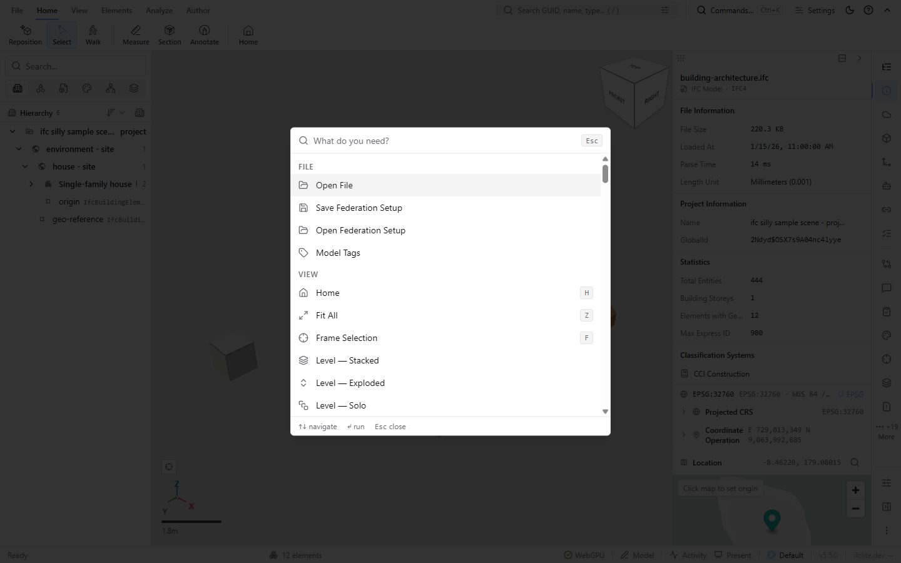
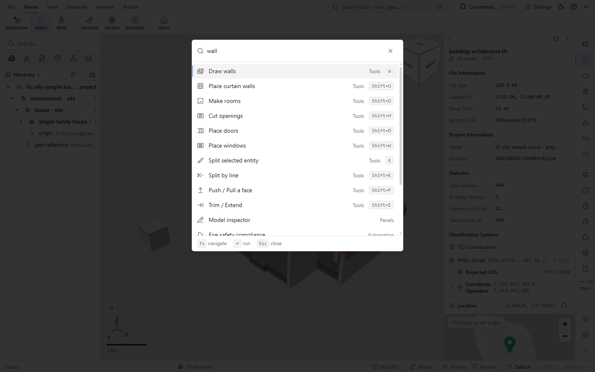
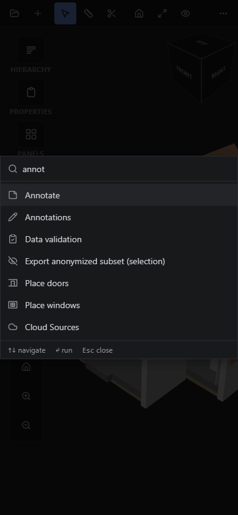
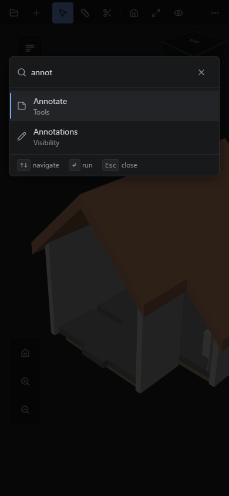
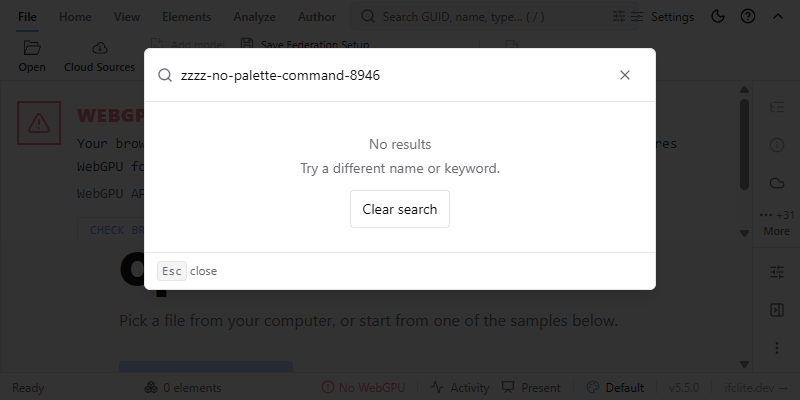
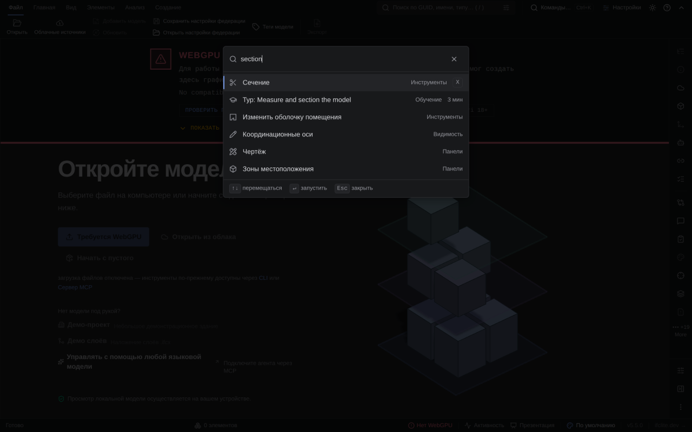
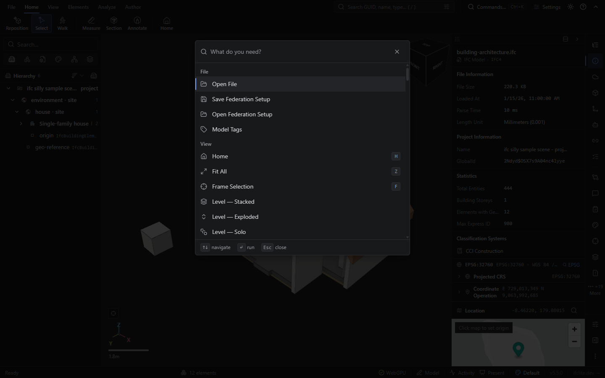

# Command palette hillclimbs

Two sequential, independently judged efforts. Each permits at most eight rounds.
Do not combine their verdicts or claim completion from a numerical taste score.

## UX — #8946

Goal: fast, predictable command discovery and execution with polished expert-tool density.
Frozen baseline source: `0f57524cfe347d29d68f53df7fc97f0b1f80d61a`.
UX accepted at round 3 on source `9d476f01e7`; full CI and PR review remain release gates.

Fixed rubric: discoverability; search relevance; keyboard/pointer predictability;
accessible focus and selected-item announcement; legibility and hierarchy;
responsive light/dark coherence; recovery from empty and unavailable states.
Vetoes: broken canonical actions, lost file-picker user activation, inaccessible
keyboard execution, new runtime errors, untranslated new UI, regressions in existing flows.

Fixed scenarios: desktop 1440×900 light/dark and narrow 390×844; fresh open,
recents, exact label, task alias, whitespace, no match then clear, arrows/Enter,
IME composition, Escape/reopen, long result list, pointer after keyboard, loaded
model and no model. Use public bundled IFC fixtures for loaded evidence.

Round record must include candidate commit, hypothesis, exact changes, independent
review objections, scenario evidence, commands/receipts/skips, accept/reject and reason.
Compare candidate against frozen baseline and last accepted candidate. Fresh Opus
taste reviews; Codex implementation; Astra reasoning/behavior review. Existing
`../pair.mjs` and council protocol can supply blind image comparisons where suitable.

| Round | Status | Hypothesis | Evidence / decision |
| --- | --- | --- | --- |
| 1 | Rejected for visual defects | Stable combobox focus, top anchoring and tiered search improve execution predictability | Ten browser scenarios passed at `8ae26bb7c0`; Opus found fuzzy noise, toast overlap and weak light selection contrast |
| 2 | Rejected for theme inconsistency | Suppress fuzzy noise when direct hits exist; distinguish selection and keep modal above notifications | All prior defects fixed, 11/11 browser pass; fresh Opus found a bright native scrollbar in dark mode |
| 3 | Accepted | Use the existing themed scrollbar and restore desktop search density | 11/11 browser scenarios passed on exact-tree CI artifact; twelve light/dark captures and Russian desktop evidence complete; fresh Opus inspected all 29 images and accepted every rubric axis, with no veto |

## Complete feature access — #8947

Starts after UX iteration. Its baseline is the accepted UX candidate, independently
captured. No implementation round started. Maximum eight rounds of its own.

Goal: every user-facing viewer feature/tool/action is reachable through a functioning
palette command or a clearly named destination opening its real flow.

Inventory every ribbon/menu/panel/contextual action, settings surface, extension
contribution and dynamic tool. Matrix columns: source surface; capability; canonical
action; palette entry/destination; task aliases; prerequisites; unloaded/loaded and
unselected/selected behavior; extension availability; evidence; remaining gap.
Duplicate entry points must map explicitly. Display-only controls must carry a reason
rather than disappearing from the inventory. Complex tools must open the actual flow.

Separate rubric: inventory completeness; functioning destination; task-language findability;
truthful context prerequisites/unavailable explanations; keyboard/grouping clarity;
no regressions to accepted UX. Missing capability or broken destination vetoes completion.
Tests alone cannot prove completeness: cross-check inventory against source surfaces.

| Round | Status | Hypothesis | Evidence / decision |
| --- | --- | --- | --- |
| — | Not started | Inventory and independent baseline follow UX acceptance | No verdict |

## Release gate

Keep issues/PRs separate (stack if necessary). Full applicable root Turbo coverage,
real UI evidence, committed pre-handoff, required CI and resolved reviews precede
Mergify readiness. Production must be verified after merge; never infer deployment.
Keep compact receipts/screenshots and close owned generated storage tasks; preserve
source, model fixtures, foreign work and unknown-outcome original receipts.

## Research and round 1 objections

Primary references: [PostHog Command K UX](https://github.com/PostHog/posthog/blob/master/frontend/src/lib/components/CommandKSearch/COMMAND_K_SEARCH_UX.md),
[Theo's relevant video](https://www.youtube.com/watch?v=xq0eB8vxeqk),
[tstack](https://github.com/t3dotgg/tstack), and the published experiments
[t3code #24865](https://github.com/pingdotgg/t3code/pull/24865) and
[#25251](https://github.com/pingdotgg/t3code/pull/25251).
Opus verified the video metadata, not its audiovisual contents; no claim of watching it.
The initially suggested video `5Bmp9cz1JN8` was not the relevant UI video.

The applicable principles are stable layout/selection, tiered local search, contextual
row labels, and fresh independent critique. PostHog's network search, AI handoff and
filter syntax are outside this palette's scope. Preserve semantic colour; council
preferences alone cannot establish correctness or justify removing useful state.

Round 1 checkpoint: `4bbaa9f045886353902d413084f1e07dd3d3575a`.
Astra's static review found selection reconciliation missing a dependency after a
whitespace edit, composition Escape reaching Radix capture dismissal, and a Happy
DOM Tab assertion that did not exercise native traversal. Coordinator corrected the
first two and added behavioral regressions; removed the misleading Tab assertions.
Real Tab traversal remains a required browser scenario. These fixes are not yet verified.

Cheap checks at the checkpoint: module size, i18n literals, diff whitespace passed.
The implementation agent's direct focused test stopped at missing built load-trace
output before assertions; it is NOT acceptance coverage. Root Turbo typecheck was
submitted through fleet as `auto-ff97536d4c494c23a2373d31e42ba82d`, storage task
`palette-ux-r1-fd0b1714`, PC job `2854b4bf-8bcd-4f51-ac12-7d6fdc0c826c`.
Its original receipt is pending; do not resubmit it to recover its outcome.

The presentation candidate adds a palette-only top anchor, ranked search tiers with
recency tie-breaking, localized mixed-result categories, clear-search recovery, and
an explicit close control. Fresh taste judgment remains pending real captures.

Fleet blocker inspection found dead recorded owners on PC. Supported original
`job-recover-capture` for job `3d1c276d-ee46-4ce4-b5fe-f08b4737575a` refused with
`active or queued resource owner`; no guard was bypassed and no foreign process or
workspace was removed. Other stale ordinary reservations do not match the deployed
service-only dead-owner recovery protocol. No bytes reclaimed by this inspection.

Combined-candidate Astra review found a blocking CSS composition error: Tailwind 4
uses independent `translate`, so inline `transform: translateX(-50%)` compounded
horizontal positioning and left inherited vertical centering active. Fixed by
removing inline transform and overriding vertical translation with `translate-y-0`.
Browser bounding rectangles before/after filtering are still mandatory. Review
found no further concrete ranking defects; this is static evidence only.

Validation continuation: candidate `a6b232e26b6ca3b559f9f3e2fe6169f067857658`
root typecheck plus full four-shard viewer suite submitted as
`auto-5bde8b6be5344c46970384a8c98accd2`, PC job
`faf298e8-1840-435d-bcc6-a086e802556f`, storage task
`palette-ux-candidate-fd0b1714`. This tests the pre-positioning-fix checkpoint,
not the final CSS fix `1d72380b1f`; final-head coverage remains required.
Both requests are queued behind original fleet reservations; keep their identities.

Git history was deepened by 220 commits for the silent-revert gate. Pre-handoff
then exited 0: all evaluated gates passed, with retained-free viewer SKIPPED
because `apps/viewer/dist` does not exist. That skip is not a built-viewer pass.
No browser captures or full test verdict yet, and no round accepted.
Coordinator escalated the concrete reservation recovery blocker to the parent
for owner coordination. No source or foreign outputs removed; no bytes reclaimed.
Owned tasks remain open while original job outcomes are pending.

## Admitted validation repair and browser setup

Draft UX PR: https://github.com/LTplus-AG/ifc-lite/pull/8950. Queue gate reports
`Mode: enforcing`; authenticated maintainer author is exempt. No ready label fabricated.

Requests `auto-5bde8b6be5344c46970384a8c98accd2` and
`auto-db9cbd907c054aebb28762aa0f3a0a94` are confirmed failed before checking code:
the shell-wrapped commands had no installed dependencies (`turbo: not found`).
The first also incorrectly forwarded `--filter` to `typecheck:tail`. These are
known failures, not uncertain outcomes. Corrected request
`auto-3266a6b51fb54c60bc8346fb806cadfd` targets production-equivalent commit
`8ae26bb7c0`, explicitly installs frozen dependencies, runs unfiltered root
`pnpm typecheck`, builds the viewer, then runs all four shards via root `pnpm test`.
The root Turbo dry-run confirmed TEST_SHARD and TEST_SHARDS reach the viewer task.
Failed-task closure was refused pending evidence verification; preserve original
publication, no source workspaces forcibly removed.

Frozen baseline build request: `auto-16416403da784015af3da6d5ee887e4e`, task
`palette-ux-baseline-fd0b1714`, source `0f57524cfe`. The temporary coordinator-owned
source worktree is `/home/louistrue/.t3/scratch/palette-baseline-fd0b1714`; remove it
when captures and task evidence are complete. It contains no unique source edits.

Ten browser scenarios are now discoverable in both viewer Playwright projects;
see `browser-scenarios.md`. Discovery is not execution. Includes desktop/narrow/short
light/dark bounds and input stability, native focus traversal, scroll-follow,
empty recovery, Escape/reopen, and real Settings execution with a bundled IFC.

## Round 1 measured outcome and round 2 candidate

This section supersedes earlier pending statuses; historical failures above remain receipts.
The corrected PC job `6135be97-00aa-4dbf-89e4-7647f3b8ba33` completed root
`pnpm typecheck` and `pnpm build:e2e` successfully at `8ae26bb7c0`; its full four-shard
viewer suite is still running. No complete suite pass is claimed.

The actual browser suite passed **10/10, zero skipped**, using the managed Windows
GPU helper and root `pnpm test:e2e:ci` at the same source. Scenarios cover all six
viewport/theme combinations, stable input position, native Tab/Shift+Tab, arrow
scroll-follow, clear recovery, Escape/reopen and Enter opening real Settings with
and without the bundled IFC loaded. The initial Linux-browser attempt timed out
capturing a screenshot; its owned test process was stopped before using the GPU
runner. Timing is incidental, not a performance benchmark.

Evidence root: `/home/louistrue/.t3/scratch/palette-ux-evidence-fd0b1714`.
`gpu-browser-result.json` records the runner and scope; `preview-observations.json`
records actual DOM rectangles and five unloaded captures. `candidate-loaded/manifest.json`
records two loaded light/dark captures, dist hash, NVIDIA adapter and no page errors.
The shared preview browser had no GPU adapter: its unloaded captures do not prove
loaded-model behavior. The separate existing GPU runner does.

Fresh Opus review `opus-round1-visual.md` rejected round 1 based on the unloaded
captures: unrelated fuzzy rows after `annot`, privacy notification over the footer
at 800×400, and a weak light-theme selected row. It preserved stable anchoring,
narrow margins, empty recovery and dark presentation. Loaded captures were produced
later and were not part of that review. No invented score or acceptance is recorded.

Round 2 removes fuzzy-only matches when any direct label, keyword or category hit
exists; preserves typo fallback; adds a semantic primary selection stripe; raises
only the palette and its scrim above toasts without dismissing them; and hides empty
navigation/run hints. New regression coverage tests translated search, annotation
results, preserved transient notifications and actual privacy-toast hit testing at
short viewport heights. Eleven browser scenarios are discoverable, not yet executed
on this revised source. Targeted lint, module size, source-text and whitespace gates
passed. Local focused tests stopped before assertions at missing sibling build output.

Cleanup: failed task `palette-ux-final-fd0b1714` was evidence-verified and closed.
Other original jobs and their locks remain protected while outcomes/publication are
reconciled. No reclaimed disk amount is claimed. Separate #8947 source inventory is
preserved outside this PR; no feature-access implementation round has started.

### Round 2 validation correction

Fresh Astra review of `7ff5de2..b65e950` found no concrete regression; it was static,
not visual acceptance. Subsequent full-suite progress exposed two failures in the
new recents tests and one old panel-entry assertion. Isolated root Turbo execution
reproduced them. Opening selected Open File beneath the newly populated recents:
the passive reconciliation effect overwrote the open effect's reset using the old
list. Reconciliation now adjusts state conditionally in the same render, preserving
the resolved identity before live insertions. Browser reopen coverage now verifies
the actual last-used Settings command is selected first. The panel test now locates
Cost/AI Chat by their accessible names, since mixed-result category text is intentional.

Focused diagnostics on the corrected working source passed **19 tests, zero skipped**
(interaction, presentation, entry and search). They use root `pnpm test --filter=@ifc-lite/viewer --only`
with the exact task confirmed by dry run and unchanged sibling outputs already built
by job6135. Temporary generated-output links are removed after diagnostics. A first
attempt without `--only` unexpectedly re-entered dependency builds due to different
Turbo environment hashes and was stopped via its owned root test process; it is not
acceptance evidence. A missing WASM runtime on the first linked-output attempt was
also a setup failure; the successful run used the real already-built runtime.

Root typecheck/build/focused validation of checkpoint `b65e950` remains queued as
`auto-f7b25554d55643998164c13bbaed7684`, PC job `bffbbdba-5ccd-4fa1-a09b-f5659181a215`.
It does not certify the later recents correction. Original baseline and full-suite
requests remain intact. The repository supports `ci:full` to request all PR lanes;
the next push uses it to obtain final-head full CI and its real viewer-dist artifact
without treating green fast CI as full coverage. The PR stays draft pending UI judgment.

The mounted fixed eight-query oracle also passed (presentation suite 5/5, zero
skipped). All 60 temporary dependency/runtime links were removed after diagnostics;
no compiled outputs were copied and no references remain. Post-commit pre-handoff
will re-evaluate cheap gates; absent local dist remains an explicit skip.

## Round 2 actual browser evidence

Frozen baseline CI run [42104971748](https://github.com/LTplus-AG/ifc-lite/actions/runs/42104971748)
built merge-queue head `b4054b32104e4839577dc8a348e43a99f74c8430`, whose tree
`ab16f045fb0c2cda8ac609278acce083976a3b97` exactly equals baseline `0f57524cfe`.
Its tested-tree artifact confirms the same tree. Viewer artifact `13453000744`
therefore supplies the frozen baseline without replaying its queued fleet request.
Baseline real browser input top moves from **214.5 to 378.5 CSS px** when browsing
144 rows versus no results at 1440×900.

Candidate CI run [42124190558](https://github.com/LTplus-AG/ifc-lite/actions/runs/42124190558)
built `a4d9e777d66d9f077592f16e079ff96f4564b6e5`, tree
`d24b957a1967c396807e86025bb846f213bcd443`, matching its tested-tree artifact.
Viewer artifact `13460770806` was used for **11/11 passing browser scenarios,
zero skipped or flaky**, through the managed Windows GPU helper. This includes
actual first-visit toast hit testing and selecting Settings as the first recent
command on reopen. These are untimed correctness checks, not benchmarks.

`capture-matrix.mjs` reuses the existing real-model scene protocol. Both builds
produced 12 corresponding captures with zero capture failures: loaded browse,
wall/annotation search, loaded narrow annotation search, narrow and short empty
states, all in light and dark. Private manifests preserve adapter, page errors,
image hashes and dist index hashes. Representative public images and compact
receipts are below. Full CI and fresh Opus visual judgment remain pending.

Shipped locale inventory correction: only English and Russian are present.
`?lang=de` negotiates to English; no German production acceptance is claimed.
German-like pseudo-catalogue tests remain useful long-label tests. Actual Russian
at 390×844 finds Section via English `section`, shows Сечение, keeps the input at
113px through pointer-after-keyboard and empty states, and retains translated
recovery/footer controls. Its screenshot is unloaded shared-preview evidence.

| Scenario | Frozen baseline | Round 2 candidate |
| --- | --- | --- |
| Loaded, desktop light |  |  |
| Loaded, narrow dark, annot |  |  |

[Machine-readable receipt](evidence/receipt.json). Original full-suite and queued
intermediate jobs remain recorded separately; these images do not convert them
to passes. Earlier unsupported-browser screenshots are not loaded-model proof.

## Round 3 bounded correction

Fresh Opus inspected all twelve round-2 candidate images, the Russian capture and
real toast screenshot. Verdict: REVISE. Six frozen rubric axes rated Good or
Excellent; responsive light/dark coherence remained Weak because the result list
used a light native scrollbar in dark mode. No veto or regression observed.

Round 3 applies the app's existing `scrollbar-thin` utility and puts category
metadata alongside the label at desktop widths, restoring one-line row density.
Narrow widths retain two-line categories for label space. The existing real
Settings/reopen browser scenario now also retains a Recent-group screenshot.
These changes do not alter ranking, action dispatch or context availability.
Round-2 screenshots/receipt remain historical evidence, not proof of this source.

## Round 3 exact-tree browser receipt

Candidate `9d476f01e7b2bfc1e69799d39a1b0289d6a6e2d3`, tree
`63f8396b08b2271c02364336e14f8f8acd0b41a4`: CI run `42127421737`,
viewer artifact `13462775595`, tested-tree artifact `13461248722`.
The downloaded index SHA-256 is
`22ebaec78936058cf5224c61b4243c0265f75ab00c7cb3230735543f4b386190`.

The original GPU capture command completed twelve scenes with zero failures or
page errors. The original root browser command completed **11/11 passed**, zero
skipped, unexpected or flaky tests (47.9 seconds; correctness run, not a benchmark).
Sixteen passed-test screenshots include real Settings activation and the Recent
group after reopening. Compact receipts, image hashes and source provenance live
in the session evidence directory under `round3-browser-result.json`,
`round3-build-provenance.json` and `round3-matrix/manifest.json`.

An additional T3 shared-browser check at 1440×900 in Russian verified English
`section` finds `Сечение`, 36px single-line rows, retained combobox focus and the
dark thin scrollbar (`rgb(48,49,53)` on `rgb(24,25,27)`). This check was unloaded
because that browser has no GPU adapter; the loaded captures above use the real
NVIDIA GPU runner. Its owned tab was closed after capture.

Fresh Opus round-3 verdict and full CI remain pending. These receipts do not
certify complete feature access (#8947), merge readiness or production deployment.

The original intermediate round-2 fleet job `bffbbdba-5ccd-4fa1-a09b-f5659181a215`
settled with exit 1 on source `b65e950dd941130f62e44878e1f5d664ae109a5f`.
Root typecheck (134 tasks, audit 4514 test files) and build (58 tasks) passed.
Focused tests failed on the known recents selection assertion fixed later in
`a4d9e777`; this run cannot certify current source. Its original receipt/log were
published and verified as manifest
`pc-wsl-bffbbdba-5ccd-4fa1-a09b-f5659181a215-65dc6f515a0c`. Storage closure refused
because a live process or T3 task still references output. The shared resources
were preserved; no forced release and zero bytes reclaimed by that close.

The original baseline build `fd328fb1-c37b-460d-a4a0-5cc9d35bdc10` subsequently
passed (58 root Turbo tasks) at frozen source `0f57524cfe347d29d68f53df7fc97f0b1f80d61a`.
Its receipt/log publication is verified as
`pc-wsl-fd328fb1-c37b-460d-a4a0-5cc9d35bdc10-fd1911efbcc2`. After this original
producer completed, supported storage closure succeeded for baseline, round 2
and validated round 1 tasks. Managed outputs are released, not claimed deleted.
The clean coordinator-owned temporary baseline source copy was removed through
Git worktree removal after checking ignored files and live cwd references; its
895,042,482 apparent bytes were redundant committed source. All unique evidence
and model fixtures remain preserved.

## UX acceptance — round 3

Fresh Opus accepted source `9d476f01e7b2bfc1e69799d39a1b0289d6a6e2d3`
after directly inspecting all twelve matrix images, the Russian desktop capture,
and sixteen browser captures. The themed scrollbar resolves the round-2 blocker;
desktop density returns to eleven complete rows while narrow layouts retain
two-line labels. All seven frozen rubric axes meet acceptance, with no veto.
See [the independent verdict](evidence/round3-review.md) and
[exact-source browser receipt](evidence/round3-browser-result.json).

The gallery candidate images now show round 3; baseline images remain unchanged.
The retained Russian narrow image is historical round-2 evidence.
File-picker activation was not rerun in this styling-only round; the earlier
mounted synchronous activation regressions passed. Full CI, public review and
production verification are separate release gates. No complete-feature-access
claim is made here: #8947 now starts from this independently accepted UX baseline.
